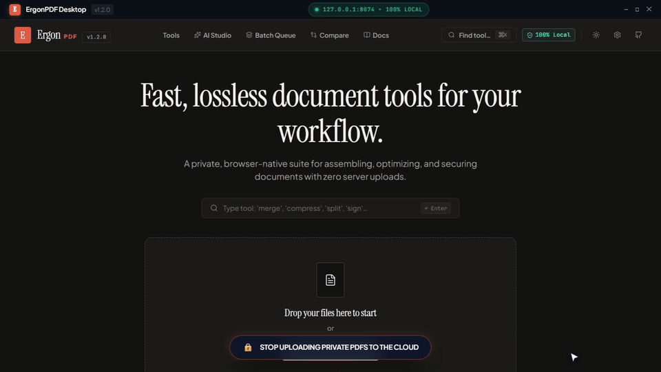

# ErgonPDF

<div align="center">



### 126 Professional PDF Tools. 100% Local. Zero Cloud. Free Forever.

**The Open-Source, Privacy-First Client-Side Document Workspace.**

[](LICENSE)
[](https://github.com/CodeSorcerer-007/ErgonPDF/actions/workflows/ci.yml)
[](https://www.typescriptlang.org/)
[-10b981?style=flat-square)](https://webassembly.org/)
[](docs/PRIVACY.md)
[](scripts/test-features.js)
[](scripts/smoke-test.js)
[](CONTRIBUTING.md)

[**Windows 1-Click Install**](INSTALLATION.md#method-1-windows-one-click-native-installer) • [**Release Notes v1.2.0**](RELEASE_NOTES_v1.2.0.md) • [**Feature Matrix (126 Tools)**](ERGONPDF_FEATURE_MATRIX.md) • [**Performance Baseline**](ERGONPDF_PERFORMANCE_BASELINE.md) • [**Architecture ADRs**](docs/adr/README.md) • [**Privacy Manifesto**](docs/PRIVACY.md) • [**FAQ**](docs/FAQ.md) • [**API Reference**](docs/API_REFERENCE.md) • [**Beta Checklist**](BETA_RELEASE_CHECKLIST.md) • [**Release Audit**](PHASE_7_FINAL_RELEASE_AUDIT.md)

</div>

---

> 🔒 **The Non-Negotiable Privacy Invariant**:  
> Most online PDF editors (ILovePDF, SmallPDF, Adobe) require uploading your files over the public internet to third-party cloud servers. **ErgonPDF never uploads your files.** Every operation (merge, split, OCR, sign, redact, compress, repair, and convert) executes strictly in your local browser memory via WebAssembly. Disconnect your Wi-Fi or run in an air-gapped facility—ErgonPDF never skips a beat.

---

## ⚡ Comparison: Why ErgonPDF?

| Feature | ErgonPDF | ILovePDF | SmallPDF | Adobe Acrobat Pro | PDF24 | Stirling-PDF |
| :--- | :---: | :---: | :---: | :---: | :---: | :---: |
| **Pricing** | **100% Free & Open Source** | Freemium ($84/yr) | Freemium ($108/yr) | Paid ($239.88/yr) | Free Proprietary | Free (GPLv3) |
| **Processing Location** | **100% Client-Side** | Cloud Server | Cloud Server | Cloud / Local | Local Desktop | Local Server |
| **File Upload Required?** | ❌ **Never** | ✅ Yes | ✅ Yes | ⚠️ Cloud features | ❌ No | ⚠️ Upload to Docker |
| **Total Tool Count** | **126 Tools** | 31 Tools | ~20 Tools | ~30 Tools | 124 Tools | ~45 Tools |
| **Offline Operation** | ✅ **Full Offline** | ❌ No | ❌ No | ⚠️ Paid | ✅ Yes | ⚠️ Needs Docker |
| **No Account / Login Needed** | ✅ **Yes** | ⚠️ Limited | ⚠️ Limited | ❌ Subscription required | ✅ Yes | ✅ Yes |
| **Windows 1-Click Installer** | ✅ **Included (.bat)** | ⚠️ Desktop (Paid) | ⚠️ Desktop (Paid) | ✅ Native Win32 | ✅ Windows EXE | ❌ Requires Docker |
| **Telemetry & Trackers** | ❌ **Zero Tracking** | ⚠️ Heavy Tracking | ⚠️ Heavy Tracking | ⚠️ Heavy Cloud Sync | ⚠️ Minor | ❌ None |
| **HIPAA / Air-Gap Ready** | ✅ **100% Compliant** | ❌ Cloud risk | ❌ Cloud risk | ⚠️ Requires BAA | ✅ Yes | ✅ Yes |

*See our full [Benchmark & Comparison Guide](docs/COMPARISON.md) for deep technical and financial analysis.*

---

## 📚 Table of Contents

- [Overview](#overview)
- [Privacy Guarantee](#privacy-guarantee)
- [Feature Directory (126 Tools)](#feature-directory)
- [Windows Desktop App Installation](#windows-desktop-app-installation-one-click)
- [Quickstart & Local Development](#quickstart)
- [Architecture](#architecture)
- [Usage Examples](#usage-examples)
- [Documentation Library](#documentation-library)
- [Verification and Testing](#verification-and-testing)
- [Contributing](#contributing)
- [License](#license)

---

## Overview

Traditional online PDF services require users to transmit sensitive legal contracts, tax records, medical charts, and financial statements to remote cloud infrastructure. This model introduces substantial data compliance risks, bandwidth bottlenecks, arbitrary file size caps, queue delays, and commercial subscription gating.

ErgonPDF takes a fundamentally different engineering approach:

- **100% Client-Side Execution**: Every document transformation, page split, rasterization, OCR recognition pass, and cryptographic hash is computed directly in local machine memory using WebAssembly, Web Workers, and HTML5 Canvas.
- **Hardware-Efficient Performance**: Operations execute with zero network transit overhead, providing near-instantaneous page manipulation and download delivery.
- **Offline Capable**: Once assets are cached by the browser, the application operates independently without an active internet connection.
- **Zero User Tracking**: No accounts, authentication walls, watermarked output, analytics trackers, or usage throttles.
- **Integrated Document Intelligence**: In-memory heuristic NLP classification, entity extraction, executive summaries, actionable item parsing, study flashcard generation, and citation-backed question answering.

---

## Privacy Guarantee

ErgonPDF guarantees complete data sovereignty:

1. **Zero Server Ingestion**: Document bytes never traverse external networks or cloud APIs. All buffers exist temporarily in browser memory and are reclaimed upon session termination.
2. **Zero Persistent Tracking**: No centralized databases, third-party analytics scripts, tracking beacons, or telemetry services exist in the code.
3. **Local Cryptographic Isolation**: File protection, user and owner passwords, and AES-256 encryption keys are derived and applied locally via standard WebCrypto primitives and WebAssembly cryptographic implementations.

---

## Feature Directory (126 Tools)

ErgonPDF organizes 126 precision utilities across nine operational categories, achieving 100% feature parity with PDF24's public suite plus local AI and duplex scanning extensions:

| Workflow Category | Count | Key Included Utilities | Processing Engine & Execution Mode |
| :--- | :---: | :--- | :--- |
| **Organize & Layout** | **17 Tools** | Merge, Split, Rearrange Pages, Assemble, Remove Pages, Extract Pages, Rotate Pages, Pages per Sheet (N-Up), Booklet Creator, Poster Print, Halve Spreads, Alternate & Mix, Crop, Change Page Size, Bookmarks, Straighten Scans | 100% In-Browser (pdf-lib) |
| **Convert & Transform** | **59 Tools** | PDF to Word, Excel, PowerPoint, Text, Markdown, HTML, RTF, EPUB, ODT, ODS, ODP, JPG, PNG, SVG, TIFF, PDF/A, plus reverse converters (Word to PDF, Excel to PDF, PowerPoint to PDF, Images to PDF, HEIC to JPG/PNG, WebP/SVG converters) | 100% In-Browser (PDF.js + Canvas + JSZip) |
| **Create & Capture** | **16 Tools** | Blank/Lined/Grid Canvas, Webcam/Phone Camera Scan, Webpage to PDF, Photo Collage, Greeting Cards, Job Application Assembler, Dynamic QR Codes, Fillable Form Designer, Electronic Invoicing (ZUGFeRD / XRechnung / Peppol XML), PDF Printer | 100% In-Browser (pdf-lib + qrcode + Canvas) |
| **Edit & Annotate** | **9 Tools** | Digital Signatures (Draw, Type, Upload, Verify), Freehand Annotations, Sticky Notes, Text Callouts, Custom Watermarks, Header/Footer Page Numbers, Letterhead Overlays, Interactive Form Filling | 100% In-Browser (Canvas + pdf-lib) |
| **Compress & Optimize** | **8 Tools** | Adaptive Lossless Compression, Raster Downsampling (DPI & Quality), Convert to Grayscale, Invert Colors (Dark Mode), Flatten Forms, Rasterize Vector Text, Repair Corrupted Streams, Web Optimize (Linearize) | 100% In-Browser (Canvas + pdf-lib) |
| **Security & Privacy** | **7 Tools** | AES-256 Document Lock, Decryption Unlock, Permanent Text & Vector Stream Redaction, Metadata & Doc Info Sanitization, Cryptographic Password Generator, Digital Signature Verification | 100% In-Browser (@pdfsmaller/pdf-encrypt + WebCrypto) |
| **View & Compare** | **7 Tools** | Fullscreen Document Reader, Side-by-Side Visual Diff Compare, Multi-Document Text Search, ISO PDF/A & PDF/UA Validator, PDF Viewer Preferences Customizer, Direct Print | 100% In-Browser (PDF.js + Canvas) |
| **OCR & Scan** | **2 Tools** | Local Multi-Threaded Tesseract OCR, Visual Copy from Scanned Documents | 100% In-Browser (Tesseract.js Web Worker + Local Traineddata) |
| **AI Document Studio** | **1 Tool** | Zero-Cloud Semantic Document Assistant: Entity Extraction, Executive Summaries, Action Items, Financial Clause Parsing, Flashcards, and Citation Q&A | 100% In-Browser (Local Heuristic NLP Engine) |

---

## Quickstart

### Windows Desktop App Installation (One-Click)

ErgonPDF can be installed on Windows as a native desktop application with Start Menu and Desktop shortcuts:

1. Clone or download this repository.
2. Double-click **`install-ergonpdf.bat`**.
3. The installer automatically checks or installs Node.js, deploys ErgonPDF to `%LOCALAPPDATA%\ErgonPDF`, creates Desktop & Start Menu shortcuts, and registers ErgonPDF in Windows Installed Apps.
4. Launch anytime from your Desktop icon or Start Menu!

For details, see [installer/README-INSTALLER.md](installer/README-INSTALLER.md).

---

### Prerequisites
- **Node.js**: Version 18.0.0 or higher (Node 20 or 22 LTS recommended)
- **npm**: Version 9.0.0 or higher

### Installation

1. Clone the repository:
   ```bash
   git clone https://github.com/CodeSorcerer-007/ErgonPDF.git
   cd ErgonPDF
   ```

2. Install pinned dependencies:
   ```bash
   npm install
   ```

3. Launch the development server:
   ```bash
   npm run dev
   ```
   Open `http://localhost:5173` in your browser.

4. Compile for production:
   ```bash
   npm run build
   npm run preview
   ```
   The compiled distribution will be hosted locally at `http://localhost:4173`.

---

## Architecture

ErgonPDF employs a layered frontend architecture that strictly decouples UI state from binary transformation services.

```text
+---------------------------------------------------------------+
|                        Browser Runtime                        |
|                     React 19 + TypeScript                     |
+---------------------------------------------------------------+
                                |
        +-----------------------+-----------------------+
        |                                               |
        v                                               v
+-------------------------------+               +-------------------------------+
|      Universal Workspace      |               |        Command Palette        |
|  - Viewport & Canvas Layers   |               |  - Ctrl/Cmd + K Intent Parser |
|  - Modular Tool Action Panels |               |  - Global Action Dispatcher   |
|  - Drag-and-Drop Thumbnails   |               |  - Direct Tool Navigation     |
+-------------------------------+               +-------------------------------+
        |                                               |
        +-----------------------+-----------------------+
                                |
                                v
+---------------------------------------------------------------+
|                   Engine Service Abstraction                  |
|                                                               |
|  PDFEngineService (Static, Stateless Document Transformations)|
|  AIService        (In-Memory NLP & Entity Recognition)        |
|  OCRService       (Sandboxed Tesseract Web Worker Engine)     |
|  StorageService   (Namespaced Local Storage & DPI Preference) |
|  QRGenerator      (Two-Dimensional Matrix Rendering)          |
+---------------------------------------------------------------+
                                |
                                v
+---------------------------------------------------------------+
|                   Core Binary Libraries (WASM)                |
|                                                               |
|  • pdf-lib               : Structural Assembly & Mutation     |
|  • pdfjs-dist            : Canvas Rendering & Text Extraction |
|  • @pdfsmaller/pdf-encrypt: AES-256 Permissions Handler       |
|  • tesseract.js          : Optical Character Recognition      |
|  • jszip                 : Binary Archive Packaging           |
+---------------------------------------------------------------+
```

For detailed architecture diagrams, component trees, data flow lifecycles, and security headers, consult [docs/ARCHITECTURE.md](docs/ARCHITECTURE.md).

---

## Usage Examples

### 1. Document Merging (UI Workflow)
1. Navigate to the application home screen.
2. Select **Merge PDF** from the directory or press `Ctrl + K` and enter `merge`.
3. Select or drop multiple PDF files into the modal dropzone.
4. Drag individual file cards to configure the desired output order.
5. Click **Merge PDFs** to instantly synthesize and download the combined document.

---

### 2. Programmatic Processing via `PDFEngineService` (TypeScript)
`PDFEngineService` exposes over 30 static methods that can be integrated into custom workflows:

```typescript
import { PDFEngineService } from './src/services/pdfEngine';

// Step A: Concatenate multiple document buffers
const mergedBytes: Uint8Array = await PDFEngineService.mergeDocuments([
  sourceBufferA,
  sourceBufferB,
]);

// Step B: Apply dynamic page numbers and watermarks
const numberedBytes: Uint8Array = await PDFEngineService.addPageNumbers(
  mergedBytes.buffer,
  {
    position: 'bottom-center',
    format: 'Page {n} of {total}',
    fontSize: 10,
    startFrom: 1,
  }
);

// Step C: Compress lossless with metadata removal
const compressedBytes: Uint8Array = await PDFEngineService.compressLossless(
  numberedBytes.buffer,
  true // Strip document metadata
);

// Step D: Apply AES-256 password protection
const protectedBytes: Uint8Array = await PDFEngineService.encryptDocument(
  compressedBytes,
  'UserPassphrase123!',
  'OwnerAdminPassphrase456!'
);
```

---

### 3. Client-Side OCR Extraction (TypeScript)
Perform Optical Character Recognition on image documents without transmitting data to external APIs:

```typescript
import { OCRService } from './src/services/ocrService';

const ocrResult = await OCRService.recognizeImage(
  scannedImageBlob,
  'eng',
  (status: string, progress: number) => {
    console.log(`OCR Progress: ${(progress * 100).toFixed(0)}% [${status}]`);
  }
);

console.log(`Extraction Confidence: ${ocrResult.confidence}%`);
console.log('Extracted Plaintext:', ocrResult.text);
```

---

### 4. Document Intelligence & Semantic Q&A (TypeScript)
```typescript
import { PDFEngineService } from './src/services/pdfEngine';
import { AIService } from './src/services/aiService';

// Extract unicode text stream from PDF
const { fullText, pageTexts } = await PDFEngineService.extractFullText(documentBuffer);

// Run local heuristic classification and entity parsing
const analysis = AIService.analyzeDocumentLocally(fullText, pageTexts);
console.log(`Document Genre: ${analysis.documentType}`);
console.log('Actionable Tasks:', analysis.actionItems);
console.log('Discovered Financial Entities:', analysis.entities.filter(e => e.type === 'amount'));

// Execute citation-backed question answering
const queryResult = AIService.answerQuery('What are the termination liabilities?', pageTexts);
console.log('Generated Response:', queryResult.answer);
console.log('Referenced Page Numbers:', queryResult.pageReferences);
```

---

## API Documentation

ErgonPDF maintains a complete OpenAPI 3.0.3 specification documenting all document processing operations, schemas, input bounds, and error models.

- **Specification File**: [docs/openapi.yaml](docs/openapi.yaml)
- **Supported Operations**:
  - `POST /pdf/inspect`: Extract metadata catalog, page counts, and dimension previews.
  - `POST /pdf/merge`: Concatenate arbitrary arrays of PDF streams.
  - `POST /pdf/split`: Partition documents into discrete page ranges.
  - `POST /pdf/compress`: Lossless object defragmentation and raster downsampling.
  - `POST /pdf/watermark`: Stamp rotated semi-transparent text banners.
  - `POST /pdf/page-numbers`: Inject sequential pagination headers or footers.
  - `POST /pdf/halve`: Bisect landscape dual-page spreads into portrait sheets.
  - `POST /pdf/nup`: Impose multi-page grids onto standard sheets.
  - `POST /pdf/booklet`: Saddle-stitch booklet signature generation.
  - `POST /pdf/crop`: Margin adjustments via `/MediaBox` and `/CropBox`.
  - `POST /pdf/resize`: Scale pages proportionally to standard dimensions.
  - `POST /pdf/alternate-mix`: Interleave duplex document streams.
  - `POST /pdf/encrypt`: Apply AES-256 standard encryption handlers.
  - `POST /pdf/repair`: Reconstruct corrupted cross-reference tables.
  - `POST /pdf/web-optimize`: Linearize streams for Fast Web View.
  - `POST /pdf/pdfa`: Embed ISO 19005-1 (PDF/A-1b) archival metadata profiles.
  - `POST /ocr/recognize`: Multi-threaded Web Worker OCR text extraction.
  - `POST /ai/analyze`: Local heuristic document classification and entity discovery.
  - `POST /ai/query`: Semantic document search with page citations.
  - `GET /health`: Operational readiness probe.

---

## Self-Hosting and Container Deployment

ErgonPDF can be self-hosted in any intranet, air-gapped laboratory, or containerized cloud environment. For complete deployment strategies (including Cloudflare Pages, Vercel, Netlify, and custom Nginx setups), consult the [User & Deployment Guide](docs/HOW_TO_USE.md).

### Using Docker Compose
```bash
docker compose up -d
```
The application will be accessible at `http://localhost:8080`.

### Using the Docker CLI
```bash
# Build production image
docker build -t ergonpdf:1.2.0 .

# Execute container under non-root unprivileged user
docker run -d -p 8080:80 --name ergonpdf ergonpdf:1.2.0
```

### Container Health Probes
- **Liveness Probe**: `GET http://localhost:8080/healthz` (returns `200 OK`)
- **Engine Status**: `GET http://localhost:8080/api/health` (returns JSON status payload)

---

## Documentation Library

ErgonPDF provides an exhaustive documentation suite modeled after the highest production standards (VoiceBox & CodexOS), covering engineering design, privacy invariants, security auditing, and user workflows:

### 🏛️ Core Architecture & Decisions
- 🏗️ **[System Architecture](docs/ARCHITECTURE.md)** — Deep dive into the reactive UI layer, Web Worker isolation, WASM binary bridges, and memory lifecycles.
- ⚙️ **[PDF Engine Internals](docs/pdf-engine-internals.md)** — Dual engine model (`pdf-lib` + `pdfjs-dist`), geometric imposition, true irreversible redaction, and WebCrypto AES-256.
- 📐 **[Architecture Decision Records (ADRs)](docs/adr/README.md)** — Comprehensive index of foundational design choices (ADR 001 to ADR 006).
- 🔒 **[Security Architecture & Threat Model](docs/security.md)** — Deep security model, zero data egress invariant, DNS rebinding guards, and traversal protections.
- 🛡️ **[Privacy Policy & Security Manifesto](docs/PRIVACY.md)** — Architectural explanation of our zero-upload guarantee, local WebAssembly sandbox, and compliance suitability (HIPAA, GDPR, NDAs).
- ⚖️ **[Responsible Use Policy](RESPONSIBLE_USE.md)** — Ethical use guidelines, redaction integrity protocols, and compliance framework alignment.
- 🔄 **[v1.0 vs v1.2 Evolution Guide](docs/V1_VS_V2_COMPARISON.md)** — Evolution from initial prototype to production architecture.

### 📊 Feature Matrices, Audits & Benchmarks
- 📑 **[System Architecture & Security Audit](ERGONPDF_AUDIT.md)** — Root system audit report modeled after CodexOS standards.
- 🗺️ **[Implementation & Expansion Roadmap](ERGONPDF_IMPLEMENTATION_PLAN.md)** — Post-v1.2.0 milestone plan for multilingual OCR and form scripting.
- 📋 **[126-Tool Comprehensive Feature Matrix](ERGONPDF_FEATURE_MATRIX.md)** — Complete audit of all 126 tools with execution engine, client-side status, and test coverage tags.
- ⚡ **[Performance Baseline & Benchmark Report](ERGONPDF_PERFORMANCE_BASELINE.md)** — Empirical measurements of cold startup latency, memory footprints (10 to 500 pages), and sub-100ms operation throughput.
- 🔍 **[Comparison & Benchmark Guide](docs/COMPARISON.md)** — Detailed feature, cost, and architectural comparison against Adobe Acrobat Pro, ILovePDF, SmallPDF, PDF24, and Stirling-PDF.
- 🛠️ **[Tools Reference Manual](docs/TOOLS_REFERENCE.md)** — Complete operational specifications for all 126 built-in tools across 9 categories.

### 💻 Installation & Operational Lifecycle
- 🚀 **[Installation & Deployment Guide](INSTALLATION.md)** — Multi-modal deployment guide: 1-click Windows native script, WinGet, Scoop, Homebrew, Docker container, and air-gapped SCIF environments.
- 🗑️ **[Uninstallation Guide](UNINSTALLATION.md)** — Clean zero-residue uninstallation runbook for Windows Desktop and local storage caches.
- 🔄 **[Upgrading Guide](UPGRADING.md)** — In-place upgrades with our zero-data-migration guarantee.
- 🪟 **[Windows Platform Integration](docs/windows-integration.md)** — Local loopback daemon, Windows Explorer context menus, Win32 path normalization, and desktop shortcuts.
- 🚢 **[Release & Multi-Format Distribution](docs/release-and-distribution.md)** — Packaging, WinGet, Scoop, Homebrew Cask, Intranet Docker, and SCIF offline deployment.
- 🏢 **[Enterprise GA Code Signing Guide](docs/ENTERPRISE_GA_SIGNING.md)** — Authenticode signing, SmartScreen reputation bootstrapping, and Microsoft Intune / GPO deployment.
- ❓ **[Frequently Asked Questions (FAQ)](docs/FAQ.md)** — Answers to 18 common questions regarding memory limits, encryption standards, and offline operation.
- 🩺 **[Troubleshooting & Diagnostics](docs/troubleshooting.md)** — Solutions for memory bounds, port conflicts, font fallbacks, and antivirus alerts.

### 👩‍💻 Developer & Release Engineering
- 🏁 **[Developer Getting Started Guide](docs/getting-started.md)** — Step-by-step developer tutorial on creating new tools, running test suites, and submitting PRs.
- 🔨 **[Building from Source](docs/building-from-source.md)** — Detailed bundler specifications, manual chunking boundaries, and static worker assets.
- 📚 **[Programmatic API Reference](docs/API_REFERENCE.md)** — Type-safe contracts and method signatures for `PDFEngineService`, `AIService`, and `OCRService`.
- 🚢 **[Release Process & Engineering Runbook](RELEASE_PROCESS.md)** — Step-by-step release engineer runbook for version synchronization, 4-gate verification, and SHA-256 manifest generation.
- 🧪 **[Testing Strategy & Quality Gates](docs/testing.md)** — Comprehensive 4-Tier test methodology covering static linting, 25 engine integrity tests, and 168 smoke-test endpoints.
- 🤖 **[AI Agent Guidelines](AGENTS.md)** — Architectural invariants and quality gates for automated coding agents.

### 🚀 Phase Reports & Release Collateral (VoiceBox Standard)
- 📝 **[Release Notes v1.2.0](RELEASE_NOTES_v1.2.0.md)** — Official release notes and distribution manifest.
- 🏷️ **[Phase 7: Release Engineering Report](PHASE_7_RELEASE_ENGINEERING_REPORT.md)** — Version audit, SHA-256 checksums, signing architecture, and build matrix.
- 🛡️ **[Phase 7: Final Release Audit Report](PHASE_7_FINAL_RELEASE_AUDIT.md)** — Executive verdict and 18-point master verification matrix.
- 🎯 **[Phase 7: Beta Qualification Report](PHASE_7_BETA_QUALIFICATION_REPORT.md)** — Beta distribution criteria, 9 tool categories, triage SLA matrix, and diagnostic protocols.
- 📋 **[Beta Release Distribution Checklist](BETA_RELEASE_CHECKLIST.md)** — Release candidate qualification checklist and artifact manifest.
- 🧪 **[Beta Testing Guide](BETA_TESTING_GUIDE.md)** — Structured testing walkthroughs across all 9 tool categories.
- 📝 **[Beta Feedback & Bug Report Template](BETA_FEEDBACK_TEMPLATE.md)** — Standardized reporting form with strict privacy scrubbing rules.
- 📣 **[Marketing & Launch Kit](docs/MARKETING_LAUNCH_KIT.md)** — Ready-to-use launch copy for Hacker News (Show HN), Reddit, Product Hunt, and Twitter/X.
- 🖼️ **[Media & Visual Assets Directory](docs/media/README.md)** — Branding guidelines, badges, and screenshot indexes.
- 📜 **[Citation File (CITATION.cff)](CITATION.cff)** — Standardized academic and software citation metadata.
- ⚖️ **[Third-Party Notices](NOTICE)** — Third-party open-source component licenses and attributions.

---

## Verification and Testing

ErgonPDF enforces a multi-tiered verification pipeline to ensure mathematical precision and stream integrity across all document transformations.

```bash
# 1. Static lint analysis with zero warnings tolerance
npm run lint

# 2. Strict TypeScript compilation and Vite production bundling
npm run build

# 3. PDF Engine Feature Integrity Suite (25 end-to-end engine tests)
npm run test-features

# 4. HTTP Application Smoke Test Suite (168 endpoint & route assertions)
npm run smoke-test
```

### Automated Benchmark Verification
To measure execution throughput, memory stability, and transformation latency:
```bash
node scripts/calculate-accuracy-and-efficiency.js
```

---

## Contributing

We welcome contributions from developers, designers, and documentation authors. Please review [CONTRIBUTING.md](CONTRIBUTING.md) for development workflows, branch naming conventions, and pull request criteria. All participants are expected to adhere to our [CODE_OF_CONDUCT.md](CODE_OF_CONDUCT.md).

Security inquiries should follow the protocols outlined in [SECURITY.md](SECURITY.md).

---

## License

ErgonPDF is open-source software licensed under the [MIT License](LICENSE).
