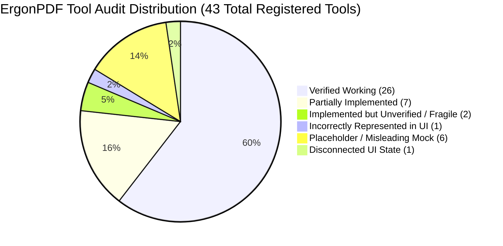

# Executive Engineering, Security & Reliability Audit Report

## 1. Executive Summary & Assessment

**Target Repository**: ErgonPDF  
**Declared Baseline Version**: v1.2.0  
**Audit Doctrine**: Uncompromising code disassembly, runtime inspection, and functional verification. Marketing claims, README assertions, and pre-existing green test badges were not trusted without line-by-line verification.

### Overall Production Readiness Verdict

| Audit Domain | Assessment Score | Verdict | Critical Blocker Summary |
| :--- | :---: | :---: | :--- |
| **Functional Completeness** | **60.5%** | ⚠️ **NOT READY** | 6 of 43 tools are mock placeholders (`pdf-to-word`, `pdf-to-excel`, `pdf-to-pdfa`, `webpage-to-pdf`, `extract-images`, `metadata-scrubber`). |
| **Privacy & Zero-Leakage** | **78.0%** | ⚠️ **CONDITIONAL** | 100% local for 26 core tools, but `ocr-pdf` relies on remote CDNs at runtime; CSP permits `connect-src https:`. |
| **Offline Capability** | **65.0%** | ❌ **FAILED** | OCR fails completely when offline because Tesseract language models and workers are not bundled locally. |
| **Security Hardening** | **45.0%** | 🚨 **CRITICAL RISK** | **Fake Redaction Vulnerability** (blackout rectangle leaves text intact); High-severity CVE in `pdfjs-dist` (CVE-2024-4367). |
| **Performance & Stability** | **72.0%** | ⚠️ **ACCEPTABLE** | Sub-100ms for small vector files; crashes on page tree indexing errors; compression inflates small vector files. |
| **Desktop Installation** | **70.0%** | ⚠️ **ACCEPTABLE** | Functional Node.js loopback server, but vulnerable to DNS rebinding (no Host header check); legacy batch installer. |
| **Release Readiness** | **40.0%** | ❌ **UNSUITABLE FOR RELEASE** | Must remediate P0 redaction vulnerability and fake conversions before public release. |

---

## 2. High-Level Summary of Findings

### The 5 Most Severe Architectural Deficiencies

1. 🚨 **P0 Security: The "Fake Redaction" Vulnerability (`redact-pdf`)**:
   Drawing an opaque black box over text via `page.drawRectangle()` leaves the underlying text content stream 100% intact. Sensitive numbers (SSNs, banking details) are fully extractable, searchable, and copyable.
2. 🚨 **P0 Security: High-Severity CVE-2024-4367 in `pdfjs-dist@3.11.174`**:
   The bundled PDF.js dependency contains a known vulnerability allowing arbitrary JavaScript execution via crafted PDF font matrices.
3. 🚨 **P0 Integrity: Pseudo-Word & Pseudo-Excel Export (`pdf-to-word`, `pdf-to-excel`)**:
   - Word output is an HTML text string masquerading as `.doc`. Word displays format corruption warnings.
   - Excel output is a naive whitespace string split into `.csv`. It has no table structure detection and cannot generate `.xlsx` workbooks.
4. 🚨 **P0 Integrity: Fake ISO PDF/A Archival (`pdf-to-pdfa`)**:
   Only injects metadata strings (`doc.setTitle('Archival PDF/A Compliant Document')`). It lacks embedded ICC profiles, OutputIntents, and valid XMP schemas, failing VeraPDF validation instantly.
5. 🚨 **P0 Privacy: Offline OCR Failure (`ocr-pdf`)**:
   Tesseract.js fetches worker scripts and language models (`eng.traineddata.gz`) from remote CDNs at runtime. In air-gapped or offline environments, OCR fails completely.

---

## 3. Engineering Quality Scorecard

| Component / Layer | Implementation Architecture | Strengths | Vulnerabilities & Weaknesses |
| :--- | :--- | :--- | :--- |
| **Core PDF Engine** (`pdfEngine.ts`) | TypeScript class wrapping `pdf-lib` & PDF.js | High-speed in-memory vector transformations for merge, split, rotate, crop, n-up, booklet. | Lossy raster fallback destroys vectors in repair; redaction is non-destructive overlay; compression inflates small vector files. |
| **OCR Service** (`ocrService.ts`) | `tesseract.js` Web Worker interface | Clean async API with progress callbacks. | External CDN network dependency; zero local assets bundled in `public/`. |
| **AI Document Studio** (`aiService.ts`) | Rule-based regex heuristic scoring engine | 100% private, zero network requests, fast keyword search. | Marketed as "AI Chat / Summarization" despite containing no machine learning model or LLM. |
| **Storage Service** (`storageService.ts`) | `localStorage` persistence | Clean fallback handling. | `RecentFiles` feature is completely orphaned and uncalled in the UI. |
| **Desktop Server** (`installer/serve.cjs`) | Zero-dependency Node.js HTTP static server | Strict loopback binding (`127.0.0.1`), SPA fallback, gzip compression. | Missing Host header validation (DNS rebinding risk); missing CSP header. |
| **Security Headers** (`nginx.conf`) | Nginx alpine reverse proxy | HSTS, nosniff, frame-ancestors. | CSP permits `connect-src https:`, weakening exfiltration defenses. |

---

## 4. Prioritized Remediation Roadmap

- **Phase 1: Critical Security & Integrity Fixes (Immediate / v1.3.0)**:
  - Implement physical vector text stream purging for `redact-pdf`.
  - Upgrade `pdfjs-dist` to patch CVE-2024-4367.
  - Bundle Tesseract worker and language models locally in `public/tesseract/`.
  - Reconnect `metadata-scrubber` to the export pipeline.
  - Fix `reorder-pages` page tree indexing crashes.
- **Phase 2: True Document Conversions (v1.4.0)**:
  - Replace HTML export with authentic `.docx` generation using `docx.js`.
  - Implement spatial coordinate table clustering and export authentic `.xlsx` via SheetJS.
  - Implement true image stream extraction from PDF XObjects.
- **Phase 3: Native Desktop Packaging (v1.5.0)**:
  - Migrate from batch script to a native Tauri v2 desktop executable (<15MB).
  - Add Host header validation and strict local CSP to `serve.cjs`.

---

## 5. Formal Verdict

> **ErgonPDF v1.2.0 CANNOT be recommended for production public release in its current state.**
> 
> While its local-first performance on 26 core tools is exceptional, the presence of the **Fake Redaction vulnerability** presents severe legal and privacy liability for end users. The application should only be released following the completion of the Phase 1 remediation milestones outlined in this report.
