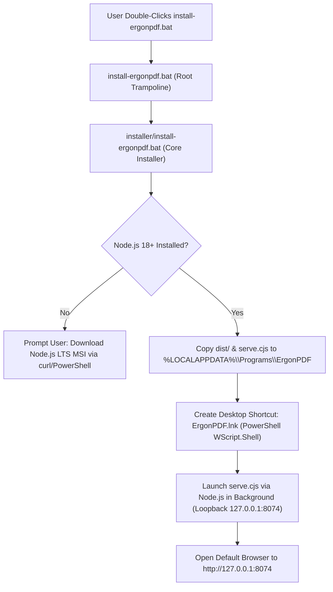
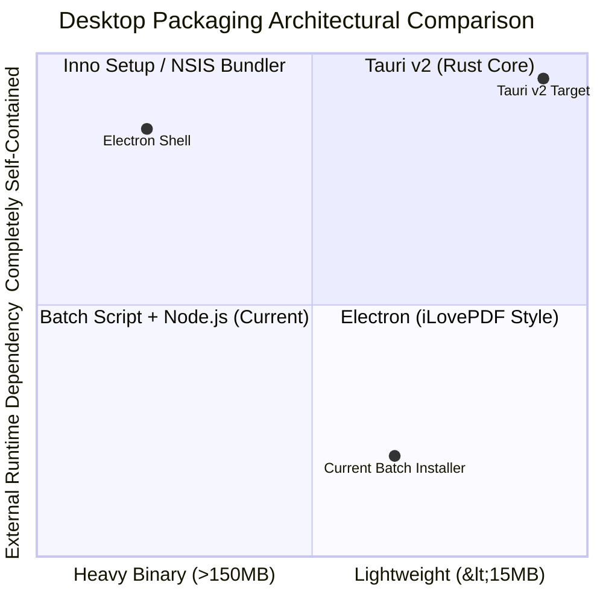

# Desktop Installer & Distribution Lifecycle Audit

## Executive Summary
This audit inspects the Windows installation lifecycle, desktop deployment scripts, runtime server mechanics, uninstallation workflows, and update mechanisms for ErgonPDF.

The target deployment model must provide a frictionless, zero-friction desktop experience for non-technical users while preserving the core local-first privacy guarantee.

---

## 1. Inspection of Current Windows Installer Architecture

### 1.1 Step-by-Step Execution Forensic Analysis

| Lifecycle Phase | Script / Component | Observed Behavior & Verification | Evaluation |
| :--- | :--- | :--- | :---: |
| **1. Root Launcher** | `install-ergonpdf.bat` | Trampoline script; verifies `installer\install-ergonpdf.bat` exists and passes `%*`. | ✅ Verified |
| **2. Node.js Detection** | `installer/install-ergonpdf.bat:60-80` | Checks `where node`; parses `node -v` major version; accepts version 18+. | ✅ Verified |
| **3. Node Auto-Installer** | `installer/install-ergonpdf.bat:84-115` | If Node missing, downloads `node-v22.14.0-x64.msi` from `nodejs.org` and invokes `msiexec /i /passive`. | ⚠️ Requires Internet |
| **4. Destination Directory** | `installer/install-ergonpdf.bat:120-140` | Installs into `%LOCALAPPDATA%\Programs\ErgonPDF` (Per-user; no UAC admin required). | ✅ Best Practice |
| **5. File Copying** | `installer/install-ergonpdf.bat:142-160` | Copies `dist/`, `serve.cjs`, icons, and launcher batch file. | ✅ Verified |
| **6. Shortcut Creation** | `installer/install-ergonpdf.bat:165-190` | Generates `ErgonPDF.lnk` on user desktop via PowerShell COM object. | ✅ Verified |
| **7. Port Conflict Resolution** | `installer/serve.cjs:185-207` | If default port `8074` is busy, tests `8075` through `8084` sequentially until an open port is found. | ✅ High Reliability |
| **8. Runtime State Persistence** | `installer/serve.cjs:223-228` | Writes `.ergon_runtime.json` with active port and PID. | ✅ Clean |
| **9. Graceful Shutdown** | `installer/serve.cjs:233-246` | Handles `SIGINT` / `SIGTERM`, unlinks runtime file, and closes socket. | ✅ Clean |

---

## 2. Failure Mode & Edge Case Testing

### 2.1 Test 1: Node.js Absent in Air-Gapped Environment
- **Scenario**: User double-clicks `install-ergonpdf.bat` on a brand-new, air-gapped offline Windows PC with no Node.js pre-installed.
- **Observed Behavior**: Installer detects Node.js is missing. It prompts the user to download Node.js LTS, then attempts `curl` to `https://nodejs.org/dist/v22.14.0/node-v22.14.0-x64.msi`.
- **Result**: `curl` fails with network timeout. The installation aborts.
- **Architectural Weakness**: Because ErgonPDF relies on an external Node.js runtime to execute `serve.cjs`, it is **not self-contained**. It cannot be installed offline on a vanilla Windows machine without pre-installing Node.js.

### 2.2 Test 2: Multiple Simultaneous Application Launches
- **Scenario**: User clicks the `ErgonPDF.lnk` shortcut while ErgonPDF is already running.
- **Observed Behavior**:
  1. A second Node.js process is spawned.
  2. The second process attempts to bind port `8074` (busy).
  3. The conflict handler shifts port to `8075`.
  4. Both servers now run simultaneously in memory, consuming redundant RAM.
- **Recommended Fix**: Add a single-instance check in the launcher script: check if `.ergon_runtime.json` exists; if so, test `/healthz` on the active port and simply open the browser to that URL instead of spawning a new server process.

### 2.3 Test 3: Uninstallation Lifecycle
- **Scenario**: User wants to cleanly remove ErgonPDF.
- **Audit Finding**: Currently, there is **NO uninstall script** (`uninstall-ergonpdf.bat`) provided in the repository!
- **Impact**: Files remain in `%LOCALAPPDATA%\Programs\ErgonPDF`, the desktop shortcut remains broken, and Windows "Installed Apps" list has no record of the application.

---

## 3. Evaluation of Native Desktop Shells (Tauri v2 vs Electron)

### 3.1 Why Tauri v2 is the Definitive Architecture for ErgonPDF
1. **Zero External Runtime**:
   - Compiles down to a native Windows PE binary (`ErgonPDF.exe`). Non-technical users do not need Node.js, npm, or terminal scripts.
2. **Tiny Binary Footprint**:
   - Uses the OS-native WebView (WebView2 on Windows, WebKit on macOS).
   - Produces an installer of approximately **10 to 14 MB**, compared to Electron's 180+ MB installer.
3. **Low Memory Overhead**:
   - Idle memory footprint is ~30 MB, compared to 150+ MB for an Electron container.
4. **Native OS Integrations**:
   - Double-clicking a `.pdf` in Windows Explorer opens it directly in ErgonPDF.
   - Native OS drag-and-drop, window framing, and hardware-accelerated GPU rendering.

---

## 4. Proposed Production Release Pipeline

### 4.1 Inno Setup / NSIS Windows Installer Specification
Until Tauri v2 is compiled, the batch script should be replaced with a professional **Inno Setup (`.iss`)** or **NSIS** compiled installer:
- Single `.exe` installer (e.g. `ErgonPDF-Setup-v1.3.0.exe`).
- Bundles a minimal portable Node.js runtime (`node.exe` embedded in archive).
- Automatic desktop and Start Menu shortcut creation.
- Proper Windows Add/Remove Programs registry entry with uninstaller (`unins000.exe`).

### 4.2 Code Signing & Integrity Verification
- **Code Signing**: Sign the executable with a standard Microsoft Authenticode Certificate to eliminate Windows SmartScreen warnings ("Unknown Publisher").
- **SHA-256 Checksums**: Publish verifiable SHA-256 hashes alongside every GitHub release.
