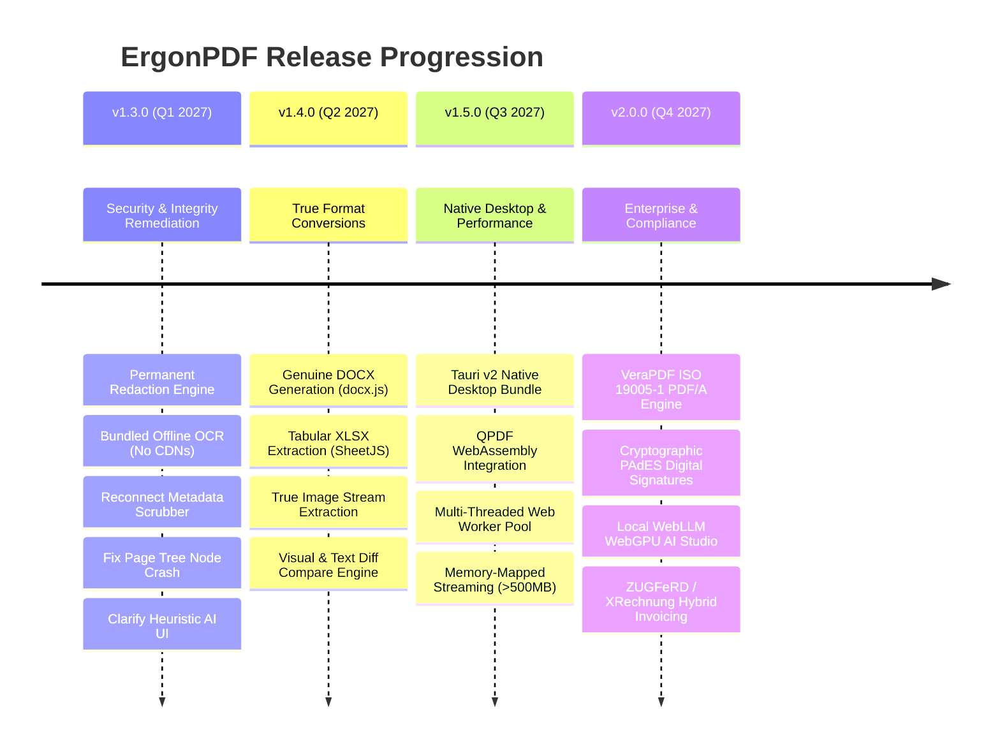

# ErgonPDF Engineering & Product Roadmap

## Roadmap Overview & Strategic Horizon
This roadmap defines the prioritized engineering milestones to transform ErgonPDF from its current baseline (v1.2.0) into the definitive open-source, local-first PDF workstation.

Every release adheres strictly to the **Non-Negotiable Privacy Invariant**: zero document data or telemetry leaves the client device.

---

## Milestone 1: v1.3.0 — Security, Integrity & Remediation (Immediate / High Priority)

### Objective
Eliminate all security vulnerabilities, placeholder mocks, and disconnected UI states identified in the Gap Analysis. Restore 100% integrity to the existing 43-tool suite.

### Key Work Streams
1. **Permanent Redaction Engine**:
   - Replace superficial `page.drawRectangle()` blackouts with a true vector-purging and raster-burn pipeline.
   - Ensure text operators under the blackout bounding box cannot be extracted via PDF.js, Acrobat, or text scrapers.
2. **100% Offline Bundled OCR**:
   - Move `tesseract.js` worker, WebAssembly binaries, and `eng.traineddata.gz` into `public/tesseract/`.
   - Reconfigure `OCRService` to load from local paths with zero network fallback.
3. **Reconnect Metadata Scrubber**:
   - Wire `metadataFields` state in `UniversalWorkspace.tsx` into `PDFEngineService.reorderAndTransformPages()`, ensuring Title, Author, Subject, and Keywords are actually updated in the exported PDF.
4. **Fix Page Tree Reordering Crash**:
   - Resolve `Cannot read properties of undefined (reading 'node')` error by sanitizing page dictionary cross-references during multi-page deletion and reordering.
5. **Reclassify & Relabel Misleading Tools**:
   - Scope `webpage-to-pdf` strictly to **"HTML Code & Snippets to PDF"** until native extensions are ready.
   - Clarify in the UI that `ai-chat` is a local heuristic document analyzer rather than a cloud LLM.
6. **Robust Image Ingestion**:
   - Harden `imagesToPDF` to support raw JPEG, PNG, TIFF, and WebP across all environments.

### Acceptance Criteria
- [ ] Attempting to copy text from redacted areas yields zero characters.
- [ ] Running OCR with network disconnected succeeds without console errors.
- [ ] Exported PDFs reflect user-entered metadata in Document Properties.
- [ ] All 85 smoke-test assertions pass with zero warnings.

---

## Milestone 2: v1.4.0 — High-Accuracy Local Conversions & Visual Diff (Q2 2027)

### Objective
Deliver industry-leading document conversion fidelity without cloud server round-trips.

### Key Work Streams
1. **Genuine Local Word (DOCX) Export**:
   - Integrate `docx` (`docx.js`) library to construct authentic Microsoft Word OpenXML zip archives.
   - Translate PDF text runs, heading hierarchies, bulleted lists, and font styles into Word AST.
2. **Spatial Coordinate Table Extraction (XLSX)**:
   - Implement 2D bounding-box spatial clustering algorithm to detect rows, columns, and data matrices.
   - Export authentic `.xlsx` binary workbooks via SheetJS / `exceljs`.
3. **True PDF Image Extraction**:
   - Parse PDF Object streams to detect `/XObject /Subtype /Image` dictionaries.
   - Extract raw embedded JPEG, PNG, and JBIG2 image streams directly into a ZIP archive without re-rasterizing whole pages.
4. **Visual & Text Diff Compare Engine**:
   - Upgrade `compare-pdf` from a basic side-by-side viewer to an active difference engine.
   - Calculate pixel-level differences using an in-memory canvas shader (highlighting additions in green and deletions in red).
   - Display side-by-side text difference highlights.

### Acceptance Criteria
- [ ] Exported `.docx` files open in Microsoft Word and Google Docs without format warnings.
- [ ] Invoices and financial tables convert into clean multi-column Excel workbooks.
- [ ] Extracting images from a 100-page document with 3 photos outputs exactly 3 image files.
- [ ] Compare tool visually highlights modified text lines between document versions.

---

## Milestone 3: v1.5.0 — Native Desktop (Tauri/Rust) & High-Performance Streaming (Q3 2027)

### Objective
Replace the batch/Node.js desktop wrapper with a native, cross-platform binary and optimize memory handling for multi-gigabyte files.

### Key Work Streams
1. **Tauri v2 Native Desktop Bundle**:
   - Package ErgonPDF as a self-contained native executable for Windows (`.msi` / `.exe`), macOS (`.dmg`), and Linux (`.AppImage`).
   - Bundle size <15 MB. Zero external runtime dependencies (no Node.js installation required).
   - Native OS file association (double-click a `.pdf` to open in ErgonPDF).
2. **QPDF WebAssembly Integration**:
   - Compile QPDF to WebAssembly (`qpdf-wasm`) for low-level PDF restructuring.
   - Deliver authentic ISO 32000 Fast Web View linearization with hint streams.
   - Advanced PDF repair: rebuild damaged XREF tables and recover streams from truncated files without lossy rasterization.
3. **Multi-Threaded Web Worker Architecture**:
   - Offload heavy operations (OCR, high-DPI rendering, compression) to a dedicated Web Worker pool.
   - Prevent UI thread freezing during 500+ page document operations.
4. **Streaming Large-Document Pipeline**:
   - Implement chunked reading via File System Access API to support 1GB+ engineering drawing sets and legal dossiers.

### Acceptance Criteria
- [ ] Windows installer runs in under 5 seconds without requiring admin rights or external runtimes.
- [ ] 500-page document operations maintain 60 FPS UI responsiveness.
- [ ] Linearized output passes standard PDF web streaming checkers.

---

## Milestone 4: v2.0.0 — Enterprise Compliance, Digital Signatures & Local AI (Q4 2027)

### Objective
Achieve institutional compliance for legal, healthcare, and enterprise deployments.

### Key Work Streams
1. **VeraPDF-Compliant ISO PDF/A Engine**:
   - Implement ISO 19005-1 (PDF/A-1b) and ISO 19005-2 (PDF/A-2b) profiles.
   - Embed standard sRGB ICC color profiles, embed all fonts, and inject complete XMP metadata packets.
   - Achieve 100% pass rate against the official VeraPDF validator.
2. **Cryptographic PAdES Digital Signatures**:
   - Implement local X.509 certificate generation and PKCS#7 / PAdES-BES digital signing using WebCrypto.
   - Allow users to import `.pfx` / `.p12` certificates or generate secure local self-signed keys.
3. **Local WebLLM WebGPU AI Document Studio**:
   - Integrate WebLLM / Transformers.js running quantized open-source models (e.g. Llama 3.2 1B or Gemma 2 2B) directly on the client's GPU via WebGPU.
   - Provide true conversational Q&A, multi-page synthesis, contract risk analysis, and translation with 100% air-gapped privacy.
4. **ZUGFeRD & XRechnung E-Invoicing**:
   - Generate hybrid PDF/A-3 documents embedding EN 16931-compliant XML invoice data for European electronic invoicing mandates.

### Acceptance Criteria
- [ ] Generated PDF/A files validated with 0 errors in VeraPDF.
- [ ] Signed documents display a valid "Digitally Signed and Certified" banner in Adobe Acrobat.
- [ ] AI Q&A executes smoothly on modern GPUs without emitting a single HTTP network packet.
