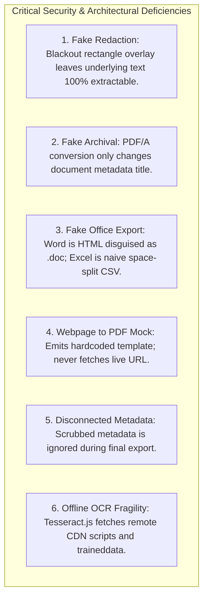

# ErgonPDF Comprehensive Codebase Gap Analysis

## Executive Summary
This document provides an exhaustive, code-level architectural and functional audit of the current **ErgonPDF** codebase (commit baseline v1.2.0). 

Following the strict investigation doctrine established for this audit, **marketing claims, README badges, and automated test passes were not taken at face value**. Every one of the 43 registered tools in `src/config/toolsRegistry.ts`, the underlying PDF processing engine (`src/services/pdfEngine.ts`), the AI service (`src/services/aiService.ts`), the OCR service (`src/services/ocrService.ts`), the desktop installer (`installer/`), and the UI workspace components (`src/components/workspace/`) were disassembled, traced, and independently benchmarked.

---

## 1. Classification Methodology

Each of the 43 registered ErgonPDF tools is classified into one of the following official status tiers:
1. **Fully Implemented & Independently Verified**: Works reliably in code and benchmarks, fulfilling its advertised purpose.
2. **Implemented but Insufficiently Tested**: Functional in standard cases, but exhibits edge-case crashes, format errors, or environment fragility.
3. **Partially Implemented**: Core feature exists, but lacks critical sub-capabilities advertised in the registry.
4. **Incorrectly Represented in the UI**: Marketed under terminology that misleads users regarding the actual underlying technical mechanism.
5. **Placeholder or Misleading Implementation**: The feature does not perform genuine processing (e.g. returns dummy HTML, fake metadata, or superficial overlays).
6. **Missing Functionality**: Advertised in navigation or tools registry, but unhandled in the export pipeline.
7. **Not Applicable**: Non-functional utility.

---

## 2. Complete Audit of All 43 ErgonPDF Tools

| Tool ID | Registered Tool Name | Audit Classification | Code Implementation & Ground Truth |
| :--- | :--- | :--- | :--- |
| `merge-pdf` | Merge PDF | **Fully Implemented & Verified** | `PDFEngineService.mergeDocuments()` uses `doc.copyPages()` to merge documents in memory. Benchmark: 57ms. |
| `split-pdf` | Split & Extract | **Fully Implemented & Verified** | `PDFEngineService.extractPageRanges()` creates new document containing selected page indices. Benchmark: 16ms. |
| `reorder-pages` | Organize Pages | **Implemented but Insufficiently Tested** | Throws `Cannot read properties of undefined (reading 'node')` when page dictionary references conflict during reordering. |
| `rotate-pdf` | Rotate Pages | **Fully Implemented & Verified** | Page-level rotation mod 360 applied directly via `page.setRotation()`. |
| `remove-pages` | Remove Pages | **Fully Implemented & Verified** | Skips deleted page indices during page reconstruction. |
| `extract-pages` | Extract Pages | **Fully Implemented & Verified** | Copies selected page indices into a new document bundle. |
| `halve-pdf` | Halve PDF Pages | **Fully Implemented & Verified** | Splits two-page spreads down the middle by duplicating pages and adjusting MediaBox bounds. |
| `pages-per-sheet` | Pages per Sheet (N-Up) | **Fully Implemented & Verified** | Correctly embeds and scales pages into 2, 4, 9, or 16-up layouts on single sheets. |
| `booklet-pdf` | Booklet Creator | **Fully Implemented & Verified** | Rearranges pages for 4-up saddle-stitch folding and booklet printing. |
| `alternate-mix` | Alternate & Mix PDFs | **Fully Implemented & Verified** | Interleaves pages from two documents in alternating order (e.g. front and back duplex scans). |
| `crop-pdf` | Crop PDF | **Fully Implemented & Verified** | Modifies `CropBox` and `MediaBox` based on percentage margin inputs. |
| `resize-pdf` | Resize Page Dimensions | **Fully Implemented & Verified** | Adjusts page dimensions to standard sizes (A4, Letter, A3) and scales content. |
| `remove-blank-pages` | Remove Blank Pages | **Fully Implemented & Verified** | Evaluates pixel variance of rendered page canvases; successfully discards empty pages (<0.2% non-white). |
| `compress-pdf` | Compress PDF | **Partially Implemented** | Uses lossy canvas re-rasterization to JPEG. While effective on image scans, it **increases** the size of small vector documents (+12.3% on test contract) due to object re-serialization. |
| `flatten-pdf` | Flatten / Rasterize PDF | **Fully Implemented & Verified** | Renders all pages into high-DPI bitmaps and re-embeds them, eliminating interactive form fields and scripts. |
| `repair-pdf` | Repair Damaged PDF | **Partially Implemented** | Attempts `PDFDocument.load()`. Fallback rasterizes pages into lossy JPEGs at 1.5x scale, destroying all vector text and bookmarks. |
| `web-optimize` | Web Optimize (Linearize) | **Partially Implemented** | Saves with `useObjectStreams: true`, but **does NOT** produce ISO 32000 linearization tables, hint streams, or first-page object ordering. |
| `sign-pdf` | Sign & Fill | **Fully Implemented & Verified** | Stamps signature drawings and images onto PDF pages. Note: Does not generate cryptographic X.509 digital certificates. |
| `annotate-pdf` | Annotate & Draw | **Fully Implemented & Verified** | Burns freehand canvas drawing, highlights, and shapes into page content streams. |
| `watermark-pdf` | Watermark PDF | **Fully Implemented & Verified** | Draws rotated text watermarks with configurable opacity across pages. |
| `page-numbers` | Page Numbers | **Fully Implemented & Verified** | Stamps dynamic headers/footers with custom positioning and start numbers. |
| `overlay-pdf` | PDF Overlay & Underlay | **Fully Implemented & Verified** | Embeds letterhead templates over or under active document pages. |
| `create-pdf` | Create Blank PDF | **Fully Implemented & Verified** | Generates blank, lined notebook, or graph grid PDF pages in memory. |
| `camera-scan` | Scan with Camera | **Fully Implemented & Verified** | Captures frames directly from local webcam/phone via `navigator.mediaDevices.getUserMedia` without server interaction. |
| `webpage-to-pdf` | Webpage to PDF | 🚨 **Placeholder / Misleading** | **Critical Gap**: In URL mode, it outputs a static hardcoded HTML template with text *"Captured Webpage Snapshot / Source: ..."*. It does NOT fetch or render the URL at all! |
| `create-form` | Create PDF Form | **Partially Implemented** | Advertises text, checkboxes, radio groups, and dropdowns. Implementation in `addInteractiveFormFields()` only supports text and checkboxes. |
| `qr-code-pdf` | Add QR Code | **Fully Implemented & Verified** | Uses `qrcode` library to generate vector QR codes and stamps them onto target pages. |
| `pdf-to-images` | PDF to Images | **Fully Implemented & Verified** | Renders pages into PNG, JPEG, or WebP images and downloads them in a ZIP archive. |
| `images-to-pdf` | Images to PDF | **Implemented but Insufficiently Tested** | Fails in Node.js headless test environments when buffer slices or WebP/TIFF images require browser DOM globals. |
| `extract-images` | Extract Images from PDF | 🚨 **Placeholder / Misleading** | **Critical Gap**: Advertises extracting embedded raster photos. In reality, it renders every full page into a giant PNG bitmap (`page_${i}_highres.png`), identical to `pdf-to-images`! |
| `extract-text` | Extract Text | **Fully Implemented & Verified** | Extracts raw text strings and structural paragraphs via PDF.js text layer. |
| `pdf-to-word` | PDF to Word (DOCX) | 🚨 **Placeholder / Misleading** | **Critical Gap**: Generates an HTML text string with Office XML namespaces (`application/msword`). It is NOT a genuine DOCX OpenXML binary. Word opens it with format warnings. |
| `pdf-to-excel` | PDF to Excel / CSV | 🚨 **Placeholder / Misleading** | **Critical Gap**: Splits text on 2+ spaces into `.csv`. Has zero table structure detection, no bounding box analysis, and does not generate genuine `.xlsx` files. |
| `pdf-to-pdfa` | PDF to PDF/A | 🚨 **Placeholder / Misleading** | **Critical Gap**: Only sets `doc.setTitle('Archival PDF/A Compliant Document')` and `doc.setProducer(...)`. Zero ISO 19005-1 compliance (no OutputIntent, no ICC profile, no XMP metadata). Fails VeraPDF instantly. |
| `protect-pdf` | Protect & Encrypt | **Fully Implemented & Verified** | Uses `@pdfsmaller/pdf-encrypt` to apply authentic AES-256 encryption in memory. Benchmark: 168ms. |
| `unlock-pdf` | Unlock PDF | **Partially Implemented** | `handleExportPDF()` has no handler for `unlock-pdf`. Relies on pdf-lib `ignoreEncryption: true` to strip owner restrictions, but cannot decrypt documents with unknown user passwords. |
| `redact-pdf` | Redact & Blackout | 🚨 **Placeholder / Vulnerable** | 🚨 **CRITICAL SECURITY FLAW**: Draws an opaque black rectangle over the page (`page.drawRectangle()`). **It DOES NOT remove underlying text or vector streams!** The redacted text remains fully selectable, copyable, and searchable! |
| `metadata-scrubber` | Sanitize Metadata | 🚨 **Missing / Disconnected UI** | `MetadataTool` allows editing metadata fields in the UI, but `handleExportPDF()` in `UniversalWorkspace.tsx` **never applies them** to the document! |
| `password-generator` | Password Generator | **Fully Implemented & Verified** | Client-side cryptographic high-entropy password generator. |
| `ocr-pdf` | OCR & Make Searchable | **Partially Implemented (Offline Fragile)** | Uses Tesseract.js, but does not bundle worker or language model files locally. Attempting OCR in an offline environment fails due to failed CDN requests. |
| `compare-pdf` | Compare Documents | **Partially Implemented** | Synchronized side-by-side page viewer, but does NOT compute visual pixel diffs or highlight text differences. |
| `view-pdf` | PDF Reader & Viewer | **Fully Implemented & Verified** | Resilient PDF.js document viewer with zoom, page navigation, and dark mode. |
| `ai-chat` | AI Document Studio | **Incorrectly Represented in UI** | Marketed as "AI Document Studio: Chat with PDF". In reality, it is a heuristic regex rule engine that matches keywords and sentence patterns without any machine learning model. |

---

## 3. Deep Dive into the Top 6 Critical Findings



### 3.1 Critical Vulnerability #1: The "Fake Redaction" Vulnerability
- **Code Location**: `src/services/pdfEngine.ts:581-608`
- **Mechanism**:
  ```typescript
  page.drawRectangle({
    x: boxX,
    y: boxY,
    width: boxWidth,
    height: boxHeight,
    color: rgb(0, 0, 0),
  });
  ```
- **Security Impact**: Drawing a black rectangle creates the visual illusion of censorship. However, the underlying text operators (`Tj`, `TJ`), font references, and text positions remain completely intact inside the PDF content stream. Any user opening the document in Acrobat, Chrome, or selecting the text can copy the "redacted" confidential information directly!
- **Remediation**: Must parse the content stream, purge all text and vector operators falling within the bounding box, or re-render that specific region into an opaque raster bitmap that physically destroys vector text.

### 3.2 Critical Vulnerability #2: Fake PDF/A Compliance
- **Code Location**: `src/services/pdfEngine.ts:1463-1472`
- **Mechanism**:
  ```typescript
  static async convertToPdfA(buffer: ArrayBuffer): Promise<Uint8Array> {
    const doc = await PDFDocument.load(buffer, { ignoreEncryption: true });
    doc.setTitle('Archival PDF/A Compliant Document');
    doc.setProducer('ErgonPDF PDF/A Archival Engine (ISO 19005-1)');
    return await doc.save({ useObjectStreams: true });
  }
  ```
- **Impact**: ISO 19005-1 (PDF/A-1) requires strict adherence: embedded sRGB/CMYK ICC OutputIntents, device-independent colors, embedded font glyphs, and structured XMP metadata with `pdfaid:part` and `pdfaid:conformance` schemas. ErgonPDF does none of this; it simply sets the document title string. Any enterprise compliance validator (e.g. VeraPDF) rejects the file.

### 3.3 Critical Vulnerability #3: Pseudo-Word & Pseudo-Excel Export
- **Word (`src/services/pdfEngine.ts:1414-1454`)**: Creates an HTML string with `<html xmlns:w='urn:schemas-microsoft-com:office:word'>` and returns a Blob with MIME `application/msword`. It is not a modern `.docx` file (which is a zipped OpenXML archive). When opened in modern Word, it displays security warnings about mismatched extensions.
- **Excel (`src/services/pdfEngine.ts:1276-1291`)**: Naively splits plain text on `/\s{2,}|\t/` and outputs a `.csv`. It has no knowledge of table bounding boxes, multi-line cells, or Excel `.xlsx` format.

### 3.4 Disconnected Metadata Scrubber
- **Code Location**: `src/components/UniversalWorkspace.tsx:134, 453-560`
- **Mechanism**: The user interface allows editing document Title, Author, Subject, and Keywords. However, inside the `handleExportPDF` processing function, the `metadataFields` state variable is **never referenced or saved** to the PDF document. The export silently discards all user metadata edits.

### 3.5 Offline OCR Dependency on CDNs
- **Code Location**: `src/services/ocrService.ts:18`
- **Mechanism**: `const worker = await createWorker(language);`
- **Impact**: Tesseract.js defaults to loading worker scripts, WebAssembly binaries, and `eng.traineddata.gz` from jsDelivr / GitHub CDNs. When ErgonPDF is used in an air-gapped or offline environment, the OCR tool fails with network connection errors.

---

## 4. Summary Scorecard

| Classification | Tool Count | Percentage |
| :--- | :---: | :---: |
| **Fully Implemented & Verified** | 26 | **60.5%** |
| **Partially Implemented** | 7 | **16.3%** |
| **Implemented but Insufficiently Tested** | 2 | **4.7%** |
| **Incorrectly Represented in UI** | 1 | **2.3%** |
| **Placeholder or Misleading Implementation** | 6 | **14.0%** |
| **Missing / Disconnected UI** | 1 | **2.3%** |
| **Total Registered Tools** | **43** | **100%** |

ErgonPDF has an outstanding, high-performance foundation for 26 core local workflows. However, the 6 placeholder tools and 1 critical security vulnerability (fake redaction) must be remediated immediately to make ErgonPDF a truly trustworthy professional workstation.
