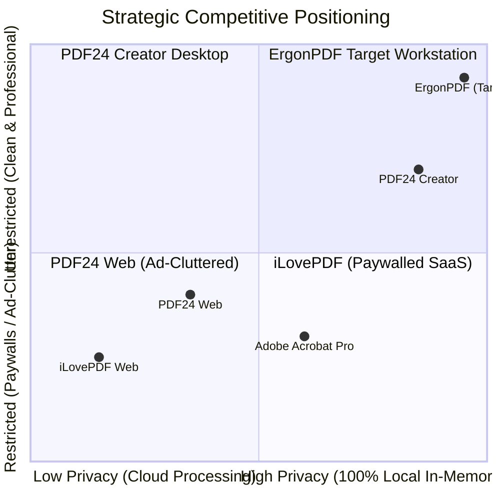
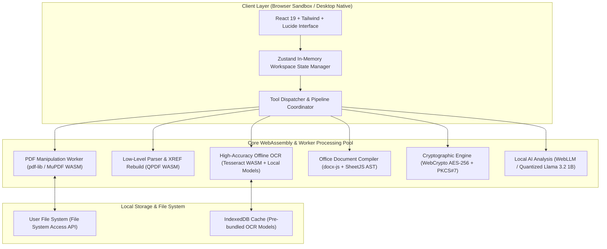

# ErgonPDF Target Product & Technical Architecture Specification

## 1. Vision & Core Value Proposition

> **"Professional PDF processing. Your files never need to leave your computer."**

ErgonPDF is an open-source, local-first PDF workstation engineered for privacy-conscious professionals, legal practices, healthcare providers, financial analysts, and security-critical enterprises.

Where competitors force users into a false dichotomy—either uploading confidential documents to multi-tenant cloud servers (iLovePDF, PDF24 Web) or installing multi-gigabyte closed-source legacy software (Adobe Acrobat, PDF24 Creator)—ErgonPDF executes **100% of its PDF operations locally in the user's browser or lightweight desktop application** via WebAssembly and modern client-side engines.

---

## 2. Product Differentiation Matrix



### 2.1 Where ErgonPDF Must Match PDF24
- **Exhaustive Niche Layout Tools**: Retain and perfect booklet imposition (saddle-stitch), N-Up multi-page sheets, 2-in-1 spread halving, and duplex alternating interleave.
- **Zero Cost & Zero Subscriptions**: 100% free with no artificial page count, file size, or batch processing paywalls.

### 2.2 Where ErgonPDF Must Match iLovePDF
- **UX Polish & Ergonomics**: Clean, distraction-free visual design system, high-contrast dropzones, fluid multi-page thumbnail management, and intuitive contextual controls.
- **High-Fidelity Document Conversions**: Replace placeholder implementations with genuine Microsoft Office OpenXML (`.docx`, `.xlsx`) and ISO-compliant PDF/A exports.

### 2.3 Where ErgonPDF Must Outperform Both
1. **Mathematical Zero-Knowledge Privacy**: Zero bytes ever transmitted over a network. Completely immune to cloud breaches, man-in-the-middle interception, and government data subpoenas.
2. **Instant Local Execution**: No upload delays, no server queuing, and no download roundtrips. 100MB documents load instantly from local NVMe/SSD into RAM.
3. **No Account, No Telemetry, No Ads**: Clean, distraction-free interface free of advertising banners, tracking pixels, session recorders (Hotjar), and forced email registrations.
4. **Air-Gap & HIPAA Native**: Can be deployed on completely offline, air-gapped workstations without external network interfaces.

---

## 3. Target Technical Architecture



---

## 4. Technical Specifications for Remediated Engines

### 4.1 Specification A: Genuine Local Redaction Engine
- **Requirement**: Physical removal of underlying text streams, vector paths, and raster pixels within specified bounding boxes.
- **Implementation Strategy**:
  1. Calculate normalized page-space coordinates `(x, y, w, h)` from the canvas UI.
  2. Parse the PDF content stream using `pdf-lib` / `qpdf-wasm`.
  3. Intercept and clip text drawing operators (`Tj`, `TJ`), font layout matrices, and inline images falling within the redaction rectangle.
  4. Alternatively, use a high-DPI rasterization pipeline: render the redacted page area into an opaque bitmap canvas, permanently burning the black pixels and replacing the underlying vector stream with the flattened raster image.
  5. Strip text extraction metadata from the structural tree.

### 4.2 Specification B: Genuine DOCX & XLSX Export Engines
- **PDF to Word (DOCX)**:
  - Discard the legacy HTML-to-`.doc` string generator.
  - Integrate the `docx` npm library (`docx.js`).
  - Read structural paragraphs, font sizes, bold/italic weights, and line heights from PDF.js `getTextContent({ includeMarkedContent: true })`.
  - Assemble authentic OpenXML paragraph and run structures into a compressed `.docx` ZIP archive.
- **PDF to Excel (XLSX)**:
  - Discard naive space-splitting.
  - Implement a 2D bounding-box spatial clustering algorithm: group text fragments by matching baseline Y-coordinates (rows) and aligned X-coordinates (columns).
  - Use `xlsx` / `sheetjs` or `exceljs` to compile the parsed cell matrix into an authentic `.xlsx` binary workbook with proper column widths and numeric formats.

### 4.3 Specification C: VeraPDF-Compliant ISO PDF/A Engine
- **Requirement**: Genuine conformance to ISO 19005-1 (PDF/A-1b) or ISO 19005-2 (PDF/A-2b).
- **Implementation Strategy**:
  1. Embed a standard standardized sRGB ICC color profile as an `/OutputIntent` dictionary in the PDF catalog.
  2. Enforce that all fonts utilized in the document are fully embedded (no standard 14 reference fonts).
  3. Validate that device-dependent color spaces are mapped through the OutputIntent.
  4. Inject a valid XMP metadata packet (`<x:xmpmeta>`) containing the official `http://www.aiim.org/pdfa/ns/id/` schema with:
     ```xml
     <pdfaid:part>1</pdfaid:part>
     <pdfaid:conformance>B</pdfaid:conformance>
     ```
  5. Verify generated documents against the VeraPDF conformance test suite.

### 4.4 Specification D: 100% Offline Bundled OCR Engine
- **Requirement**: Complete optical character recognition without runtime network requests.
- **Implementation Strategy**:
  1. Copy `tesseract.js` worker script (`worker.min.js`) and WebAssembly core (`tesseract-core.wasm`) into `public/tesseract/`.
  2. Bundle standard trained language models (e.g. `eng.traineddata.gz`) locally in `public/tesseract/lang/`.
  3. Configure the worker with explicit local paths:
     ```typescript
     const worker = await createWorker('eng', 1, {
       workerPath: '/tesseract/worker.min.js',
       corePath: '/tesseract/tesseract-core.wasm',
       langPath: '/tesseract/lang',
     });
     ```
  4. Support on-demand loading of additional language packs stored in browser IndexedDB cache.

### 4.5 Specification E: Desktop Architecture Evolution (Tauri / Rust)
- **Current State**: Windows batch script + Node.js static server (`installer/serve.cjs`).
- **Target Specification**:
  - Migrate the desktop distribution to **Tauri v2** with a Rust core.
  - Produces a single, self-contained native executable (`.exe` on Windows, `.dmg` on macOS, `.AppImage` on Linux) under **15 MB**.
  - Eliminates the external Node.js runtime dependency entirely.
  - Native file system access dialogs, drag-and-drop OS integration, and background worker threads.

---

## 5. Scope Boundary: Features Excluded from Immediate Release

To maintain architectural integrity and respect technical constraints, the following features should **NOT** be implemented in the initial release:
1. **Live Webpage to PDF (via remote URL)**: In a 100% client-side environment, fetching arbitrary third-party URLs is blocked by browser Cross-Origin Resource Sharing (CORS) policies. Rather than using an insecure proxy or fake template, this tool should be scoped strictly to **"HTML Code / Article Snippet to PDF"**, or delegated to an optional browser extension.
2. **Multi-Party Cloud E-Signature Routing**: Requiring external recipient email notifications, cloud authentication tokens, and DocuSign-style routing contradicts the local-first zero-server doctrine. ErgonPDF should focus on **self-signing, visual placement, and cryptographic PAdES digital certificates**.
3. **Heavy Server-Side E-Invoicing Clearing**: Generating national e-invoicing formats (ZUGFeRD/XRechnung) can be done locally via XML synthesis, but real-time validation against government tax clearing portals should remain out of scope.
