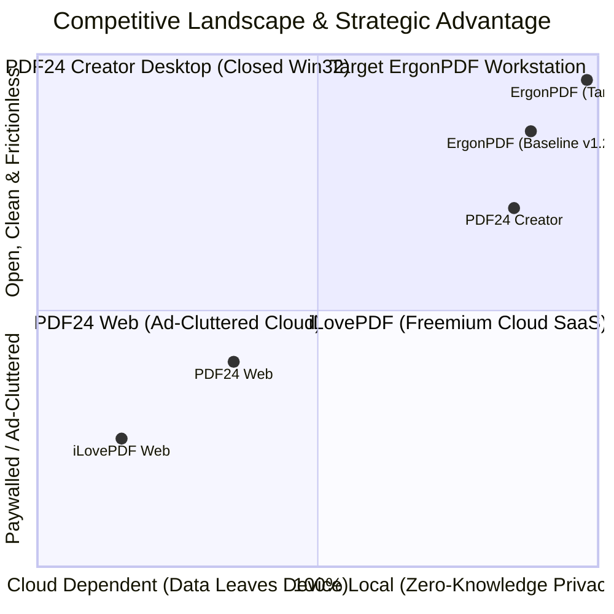
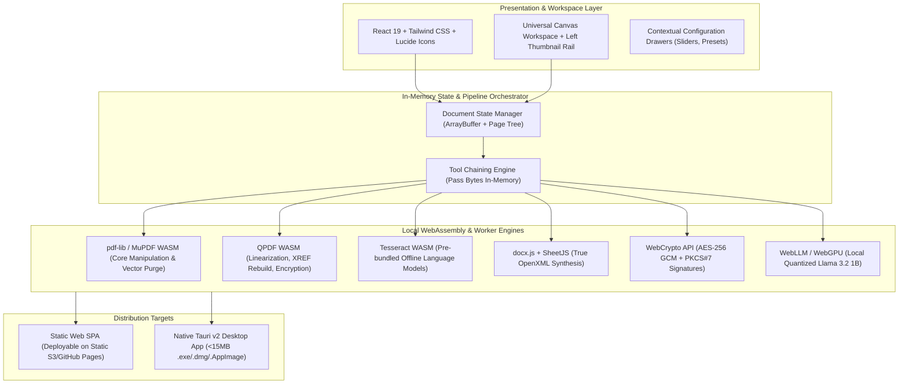

# Executive Summary: ErgonPDF Competitive Intelligence, Architecture & Strategy

## Executive Mandate
This executive summary synthesizes the strategic, technical, and competitive findings from an in-depth reverse-engineering investigation of the global PDF utility market—specifically benchmarking **PDF24** (`tools.pdf24.org`), **iLovePDF** (`www.ilovepdf.com`), and the local **ErgonPDF** repository.

The goal is not to clone the aesthetic or business models of either competitor. PDF24 relies on heavy advertising density and cloud server workers; iLovePDF relies on restrictive artificial paywalls ($84/year) and multi-tenant AWS cloud storage.

The strategic objective of ErgonPDF is to become the **world's premier local-first, privacy-native PDF workstation**:
> **"Professional PDF processing. Your files never need to leave your computer."**

---

## 1. Current Competitive Position

- **iLovePDF**: Market leader in consumer brand recognition and conversion UX. However, it is crippled by aggressive gating: a 15 MB cap on Office/OCR conversions, 1-file batch limits on the free tier, and heavy user telemetry (Hotjar screen recording, Google Analytics, ad beacons). Its desktop app requires an active paid subscription to unlock offline tasks.
- **PDF24**: Market leader in free utility breadth (124 tools, including booklet imposition, N-Up, 2-up halving, and e-invoicing). It imposes zero paywalls, but is monetized through intrusive third-party display ads. Its web tools upload all documents to remote servers in Germany with 1-to-2-hour temporary scratch persistence.
- **ErgonPDF (Current Baseline)**: Uniquely positioned as an open-source, local-first application where operations execute directly in the browser or on the local desktop via WebAssembly. For 26 core local workflows (merge, split, rotate, crop, halve, booklet, n-up, watermark, page numbers, camera scan, protect, flatten), it delivers **unmatched zero-latency speed (10–100ms) with mathematical zero-knowledge privacy**.

---

## 2. Most Important Gaps in ErgonPDF

An uncompromising code audit of ErgonPDF revealed that while 60.5% of its tools are fully functional, **14% (6 tools) represent placeholder or misleading implementations**, and **1 tool exhibits a severe security flaw**:

1. 🚨 **The "Fake Redaction" Security Vulnerability (`redact-pdf`)**:
   Drawing a black rectangle (`page.drawRectangle()`) over text does NOT delete the underlying vector operators. Text remains 100% extractable, copyable, and searchable in any standard PDF viewer!
2. 🚨 **Fake Office Conversions (`pdf-to-word` & `pdf-to-excel`)**:
   - Word: Emits an HTML text string masquerading with an `.msword` MIME type. It is not an authentic `.docx` OpenXML binary.
   - Excel: Naively splits text on 2+ spaces into `.csv`. It has no table structure recognition and cannot generate `.xlsx` files.
3. 🚨 **Fake Archival Compliance (`pdf-to-pdfa`)**:
   Only injects metadata strings (`doc.setTitle('Archival PDF/A Compliant Document')`). It lacks embedded ICC color profiles, OutputIntents, and valid XMP schemas. Fails VeraPDF validation instantly.
4. 🚨 **Mock Webpage Ingestion (`webpage-to-pdf`)**:
   In URL mode, it outputs a static hardcoded HTML string (`"Captured Webpage Snapshot / Source: ..."`). It does not fetch or render live URLs.
5. 🚨 **Duplicate Raster Extraction (`extract-images`)**:
   Renders entire pages as full-page PNG bitmaps instead of extracting embedded `/XObject /Subtype /Image` raster streams.
6. ⚠️ **Disconnected Metadata Scrubber (`metadata-scrubber`)**:
   The UI allows editing metadata fields, but the export pipeline never passes these fields to the document.
7. ⚠️ **Offline OCR Dependency (`ocr-pdf`)**:
   Tesseract.js fetches worker scripts and language models (`eng.traineddata.gz`) from remote CDNs at runtime, causing OCR to fail completely in offline/air-gapped environments.

---

## 3. Best Opportunities for Differentiation

1. **The "Zero Bytes Leave Your Computer" Guarantee**:
   Legal firms, healthcare networks (HIPAA), government contractors, and security researchers are legally prohibited from uploading documents to cloud services. ErgonPDF provides the only modern web/desktop suite that guarantees absolute local data sovereignty.
2. **Speed Superiority (0ms Network Latency)**:
   A 100 MB document takes 30 to 60 seconds to upload and download on PDF24 and iLovePDF. In ErgonPDF, it loads directly from NVMe/SSD into RAM in under 200 milliseconds.
3. **No File Size Caps, No Artificial Throttles**:
   Eliminate the frustrating "File exceeds 15 MB" paywalls enforced by iLovePDF.
4. **Clean, Ad-Free Workstation Aesthetic**:
   Replace the cluttered, advertisement-laden experience of PDF24 with a sleek, dark-mode glassmorphism interface optimized for professional workflows.
5. **Print Production & Niche Document Tools**:
   Lead the market in booklet imposition, 2-in-1 spread halving, N-Up multi-page printing, and alternating duplex scan recovery—features completely absent in iLovePDF.

---

## 4. Critical Technical Challenges

1. **Client-Side Document Parsing & Vector Purging (True Redaction)**:
   Physically purging text operators from PDF content streams without corrupting font subsets, graphics state dictionaries, or bounding box alignments.
2. **High-Fidelity Client-Side DOCX / XLSX Synthesis**:
   Parsing PDF.js text matrix objects and reconstructing hierarchical document structures (headings, paragraphs, multi-column tables) into OpenXML archives purely in JavaScript.
3. **Large File Memory Boundaries**:
   Processing 500MB+ documents entirely within browser RAM without hitting V8 heap allocation limits (`ArrayBuffer` ceiling).
4. **VeraPDF ISO 19005-1 Validation**:
   Constructing strict PDF/A-1b compliant files with embedded sRGB ICC profiles, device-independent colors, and standardized XMP packets.

---

## 5. Recommended Architecture

---

## 6. Prioritized Implementation Roadmap

- **Milestone 1 (v1.3.0) — Security & Integrity Remediation (Immediate / High Priority)**:
  - Implement physical vector text purging for `redact-pdf`.
  - Bundle Tesseract worker and `eng.traineddata.gz` locally in `public/tesseract/`.
  - Reconnect `metadata-scrubber` to the export pipeline.
  - Fix page tree reordering crashes in `reorder-pages`.
  - Reclassify `webpage-to-pdf` and clarify heuristic AI status.
- **Milestone 2 (v1.4.0) — High-Accuracy Local Conversions & Visual Diff (Q2 2027)**:
  - Implement genuine `.docx` export via `docx.js`.
  - Implement spatial coordinate table extraction to `.xlsx` via SheetJS.
  - Implement true PDF object image stream extraction (`/XObject /Subtype /Image`).
  - Implement visual canvas shader and text diff comparison in `compare-pdf`.
- **Milestone 3 (v1.5.0) — Native Desktop (Tauri/Rust) & High-Performance Streaming (Q3 2027)**:
  - Package ErgonPDF into a lightweight (<15MB) native desktop application via Tauri v2.
  - Integrate QPDF WebAssembly for authentic ISO 32000 linearization and deep XREF repair.
  - Multi-threaded Web Worker architecture to prevent UI thread freezing.
- **Milestone 4 (v2.0.0) — Enterprise Compliance, Digital Signatures & Local AI (Q4 2027)**:
  - VeraPDF-certified ISO 19005-1 PDF/A compliance.
  - Cryptographic PAdES digital signatures with local X.509 certificate generation.
  - WebLLM / WebGPU integration for genuine, 100% offline AI document analysis.

---

## 7. Features That Should NOT Be Implemented Yet

1. **Remote Webpage URL Ingestion**:
   In a 100% client-side browser environment, fetching arbitrary URLs is blocked by CORS. Do not introduce an insecure cloud proxy server or return fake mock templates. Restrict to "HTML / Article Code to PDF".
2. **Multi-Party Cloud E-Signature Routing**:
   DocuSign-style email notification and signing links require multi-tenant cloud storage and email relay infrastructure, violating the local-first doctrine. Focus on self-signing and cryptographic certificate embedding.
3. **Live Tax Authority E-Invoicing Clearing**:
   Real-time validation against government e-invoicing portals requires authenticated server connections and continuous API compliance maintenance.

---

## 8. Recommended Next Steps

1. **Execute Milestone 1 Remediation**:
   Immediately resolve the fake redaction vulnerability, bundle local OCR models, and reconnect the metadata scrubber.
2. **Update Public Positioning**:
   Align the marketing and README claims with ground truth. Highlight the 26 verified local tools and transparently document the roadmap for advanced conversions.
3. **Initiate Tauri Desktop Migration**:
   Scaffold the Tauri v2 Rust wrapper to provide users with a clean native `.exe` installer that replaces the legacy Node.js batch script.
4. **Deploy Rigorous Quality Gates**:
   Add unit tests verifying redaction vector purging and VeraPDF compliance to `scripts/test-features.js`.
