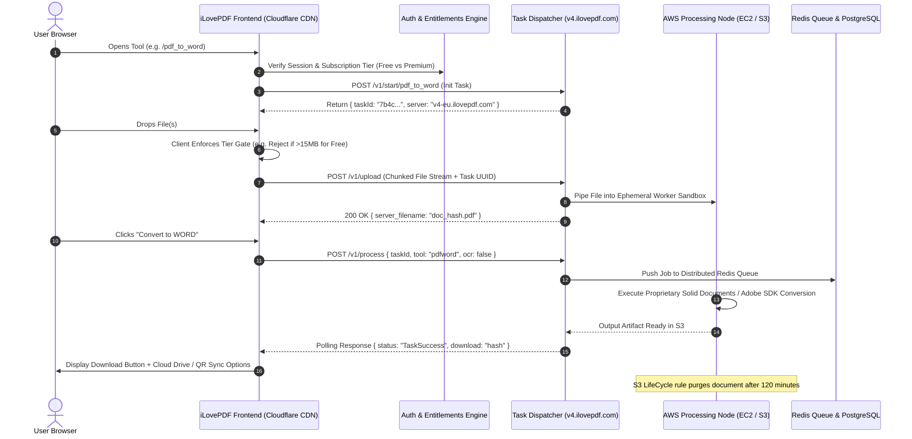

# iLovePDF Competitor Intelligence & Reverse Engineering Report

## Executive Overview
**iLovePDF** (operated by iLovePDF SL, Barcelona, Spain; primary domain: `https://www.ilovepdf.com/`) is the global market leader in consumer and small-business cloud PDF management. Founded in 2010, iLovePDF processes over 100 million document tasks monthly.

Unlike PDF24's ad-monetized free utility model, iLovePDF is a **venture-scale commercial SaaS enterprise operating an aggressive freemium conversion funnel**. It employs strict artificial quotas on file size, batch size, and advanced features (such as OCR and high-fidelity Office conversion) to drive users toward recurring annual subscriptions ($84/year) or business team plans.

---

## 1. Technical Architecture & Ingestion Lifecycle

### 1.1 Web Application Architecture
Inspection of network calls, DOM elements, and JavaScript bundles across `www.ilovepdf.com` reveals a high-throughput, distributed cloud architecture:
- **Frontend Stack**: Vue.js / Nuxt-based responsive single-page architecture with dynamic asset chunking and multi-CDN distribution (Cloudflare + AWS CloudFront).
- **Session & Task Allocation**:
  - Every tool execution generates a dynamic session token and server endpoint allocation.
  - Inspection of client scripts reveals a dedicated server routing pattern:
    ```javascript
    var taskId = '3b9f8a...'; // 32-character hexadecimal UUID
    var server = 'v4.ilovepdf.com'; // Dynamic load-balanced processing node
    ```
  - The client uploads files directly to designated regional worker clusters using chunked HTTP multipart streaming.



### 1.2 Processing Engines & Cloud Infrastructure
1. **Proprietary High-Fidelity Converters**:
   - For PDF to Word, Excel, and PowerPoint, iLovePDF does not use basic open-source libraries like pdf-lib or poppler.
   - Instead, iLovePDF integrates commercial high-accuracy PDF reconstruction SDKs (such as **Solid Documents SDK** or commercial **Adobe PDF Services**), which reconstruct paragraph styles, complex tabular matrices, and vector art into authentic Microsoft Office OpenXML (`.docx`, `.xlsx`, `.pptx`) structures.
2. **Cloud Infrastructure**:
   - Hosted on **Amazon Web Services (AWS)** across multiple global regions (us-east-1, eu-west-1, ap-southeast-1).
   - Redis cluster for job dispatching and state coordination.
   - Amazon S3 bucket storage with explicit 120-minute lifecycle expiration policies.
3. **Data Retention & Privacy Enforcement**:
   - All uploaded documents are automatically purged from AWS S3 servers **2 hours** after task completion.
   - Immediate manual deletion is offered to users via an in-app trash can icon.
   - iLovePDF claims ISO/IEC 27001 certification and GDPR compliance.

---

## 2. Freemium Tier Structure & Artificial Gating

Our deep crawl of `https://www.ilovepdf.com/pricing` and tool configurations exposed the exact limits enforced on free users:

### 2.1 File Size & Batch Processing Limits Matrix

| Workflow / Tool | Free Web Tier Limit | Premium Web Tier Limit | Premium Desktop App Limit |
| :--- | :---: | :---: | :---: |
| **Merge PDF** | Max **25 files** / 100 MB | Max **500 files** / 4 GB | **Unlimited** / No File Size Cap |
| **Split PDF** | Max **1 file** / 100 MB (Manual) | Max **1 file** / 4 GB (Smart split up to 200 pgs) | **Unlimited** |
| **Compress PDF** | Max **2 files** / 200 MB | Max **10 files** / 4 GB | **Unlimited** |
| **PDF to Word** | Max **1 file** / 15 MB (Basic text only) | Max **10 files** / 4 GB (**OCR Enabled**) | **Unlimited** with Local OCR |
| **PDF to Excel** | Max **1 file** / 15 MB (Basic tables) | Max **10 files** / 4 GB (**OCR Enabled**) | **Unlimited** with Local OCR |
| **PDF to PowerPoint** | Max **1 file** / 15 MB | Max **10 files** / 4 GB | **Unlimited** |
| **OCR PDF** | Max **1 file** / 15 MB (Standard) | Max **10 files** / 4 GB (Advanced OCR) | **Unlimited** |
| **PDF to JPG / PNG** | Max **2 files** / 25 MB | Max **10 files** / 4 GB | **Unlimited** |
| **Images to PDF** | Max **20 files** / 40 MB | Max **500 files** / 4 GB | **Unlimited** |
| **Sign PDF** | Max **3 files** / 50 MB | Max **5 files** / 50 MB (Audit Trail + AES) | **Unlimited** |
| **Redact PDF** | Max **1 file** / 400 MB | Max **1 file** / 400 MB (Smart pattern redact) | **Unlimited** |
| **Compare PDF** | Max **2 files** / 400 MB | Max **2 files** / 400 MB | **Unlimited** |
| **AI Summarizer** | Max **1 file** / 50 MB | Max **1 file** / 50 MB (67 AI credits/mo) | **Unlimited** |
| **PDF to Markdown** | Max **1 file** / 15 MB | Max **1 file** / 200 MB | **Unlimited** |

### 2.2 Paywalled & Gated Features (Subscription-Only)
The following capabilities cannot be accessed by free users:
1. **OCR-Assisted Office Conversion**: Converting scanned PDFs to editable Word/Excel documents with optical character recognition is 100% paywalled behind the Premium subscription.
2. **Batch Processing Multipliers**: Free users are restricted to 1 or 2 files per batch for most complex tasks.
3. **Advanced Electronic Signatures (AES)**: Biometric signatures, timestamping authority (TSA), and legally binding audit certificates.
4. **Ad-Free Workspace**: Free web users are subjected to Google Display Network banner ads.
5. **Full Offline Desktop App**: The desktop application requires an active paid account to unlock unlimited offline document processing.

---

## 3. Interaction Reverse Engineering: Representative Workflows

### 3.1 Workflow A: PDF to Word (`/pdf_to_word`)
1. **Hero Upload Zone**: Large red call-to-action button: "Select PDF file".
2. **File Size Interception**: If a user drops a file exceeding 15MB, a client-side modal immediately blocks ingestion:
   > *"File size exceeds 15 MB limit. Upgrade to Premium to convert files up to 4 GB."*
3. **Conversion Options Panel**:
   - Exposes two cards:
     - **No OCR (Free)**: Converts native text; warns that scanned images will remain uneditable images.
     - **OCR (Premium)**: Grayed out with a golden crown icon for free users. Clicking prompts upgrade to Pro ($84/year).
4. **Execution & Feedback**:
   - Converts remotely on AWS cluster.
   - Progress bar with percentage counter and animated conversion graphic.
5. **Download & Upsell**:
   - Direct download button for `.docx`.
   - QR code to send file to mobile phone.
   - Persistent banner advertising iLovePDF Desktop.

### 3.2 Workflow B: Sign PDF (`/sign-pdf`)
1. **Persona Selection**: Asks: *"Only me"* (Self-signing) vs *"Several people"* (Digital signature request workflow).
2. **Signature Creator**:
   - Draw (Canvas stroke with smoothing algorithm).
   - Type (Pre-rendered cursive fonts).
   - Upload (PNG image transparency crop).
3. **Placement Canvas**: Interactive page-by-page viewer allowing drag-and-drop placement of Signature, Initials, Date, and Name fields.
4. **Download**: Merges signature vectors into PDF. Premium users receive a verifiable cryptographic signature and audit trail certificate.

---

## 4. Privacy, Tracking, and Telemetry Audit

Reverse engineering of network traffic on `ilovepdf.com` reveals significant telemetry and tracking infrastructure:
- **Third-Party Telemetry Endpoints**:
  - Google Analytics 4 (`www.google-analytics.com`)
  - Google Tag Manager (`www.googletagmanager.com`)
  - Hotjar (`static.hotjar.com` - session recording & heatmap capture)
  - Google DoubleClick / Ads (`stats.g.doubleclick.net`)
  - Segment / Amplitude analytics beacons
- **Document Exposure Risk**:
  - While iLovePDF guarantees automated deletion after 2 hours, documents reside on multi-tenant AWS cloud storage during processing.
  - Transmission over public internet exposes metadata (file names, upload timestamps, file sizes) to cloud network logs.

---

## 5. Desktop Application: iLovePDF Desktop

- **Packaging**: Built on the **Electron framework** (Node.js runtime bundled with Chromium) for Windows and macOS (~180MB download).
- **Hybrid Operation**:
  - The desktop application performs some simple operations (e.g. merge, split, rotate) locally on the client CPU.
  - For advanced operations (OCR, PDF to Word/Excel conversion), the desktop app silently uploads the file to iLovePDF cloud servers via API keys tied to the user's login account!
- **Commercial Lock**: Offline batch processing is locked behind the paid Premium tier. Free users cannot use the desktop app as an offline utility.

---

## 6. Competitive Strengths & Weaknesses

### Strengths
1. **Exceptional Conversion Quality**: Industry-leading accuracy in PDF to Word and Excel conversion using commercial reconstruction engines.
2. **Sleek, Modern User Interface**: Polished design system, clean typography, intuitive drag-and-drop interactions, and minimal visual friction.
3. **Omnichannel Ecosystem**: Unified accounts across Web, Mobile (iOS/Android), Desktop, and REST API.
4. **Full E-Signature Solution**: `iLoveSign` competes effectively with DocuSign for basic document execution.

### Weaknesses
1. **Aggressive Paywalls**: 15MB file cap and 1-file batch restrictions make free usage frustrating for real-world business documents.
2. **Paywalled OCR**: Inability to convert scanned documents to Word/Excel without paying $84/year.
3. **Privacy Vulnerability**: Multi-tenant cloud upload is unacceptable for privacy-sensitive industries (legal, healthcare, finance).
4. **Telemetry Overhead**: Heavy tracking, session replay scripts, and third-party advertising cookies.
