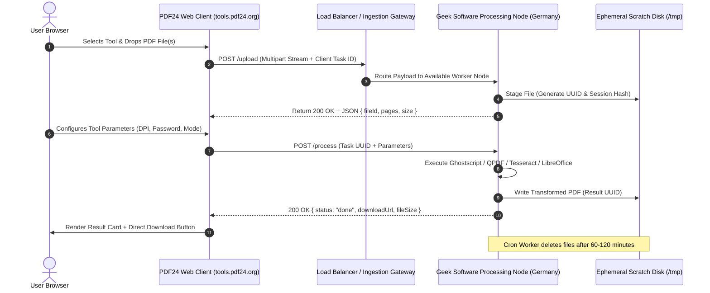

# PDF24 Competitor Intelligence & Reverse Engineering Report

## Executive Overview
**PDF24** (operated by Geek Software GmbH, Berlin, Germany; primary domain: `https://tools.pdf24.org/en/`) is one of the world's most widely utilized free PDF utility suites. Originally created in 2006 as a Windows desktop virtual printer tool ("PDF24 Creator"), PDF24 transitioned heavily into a web-based SaaS platform while maintaining a companion Windows desktop application.

Unlike venture-backed or freemium competitors that enforce aggressive paywalls, PDF24 operates under an **ad-monetized, 100% free web utility model**. It provides an extensive collection of **124 distinct tools, workflows, and format converters** without requiring user registration, subscriptions, or credit cards.

---

## 1. Technical Architecture & Ingestion Lifecycle

### 1.1 Web Application Architecture
Reverse engineering of `https://tools.pdf24.org/en/` and individual tool pages reveals a server-centric, hybrid processing model:
- **Frontend Stack**: Server-rendered HTML (PHP/Linux stack) augmented with jQuery, native JavaScript, CSS grid systems, and custom dropzone upload handlers.
- **Client Ingestion Engine**:
  - Drag-and-drop zone (`.fileDropArea`, `dropzone`) accepts single or multiple files.
  - Client verifies MIME types and extensions locally, then dispatches asynchronous multipart HTTP POST requests to backend upload endpoints.
  - Supports Google Drive and Dropbox file picker integration via OAuth popup modals.
  - Supports smartphone/webcam QR code upload (`data-action="mobile-upload"`), which creates a temporary server pairing token allowing users to photograph a physical document on their phone and beam it into the active desktop browser session.

### 1.2 Processing Workers & Backend Technology
Observable server responses and error messages establish that PDF24's web operations are **executed entirely on backend cloud servers**:
1. **Underlying Engines**:
   - **Ghostscript (`gs`)**: Primary PDF rasterizer, postscript compiler, color space converter (RGB to CMYK/Grayscale), and linearizer.
   - **QPDF**: Structure normalization, object defragmentation, encryption (RC4, AES-128, AES-256), and linear fast web view generation.
   - **Tesseract OCR**: Multilingual optical character recognition engine with language packs.
   - **LibreOffice / OpenOffice headless**: Conversion of Microsoft Office formats (DOCX, XLSX, PPTX) and OpenDocument formats (ODT, ODS, ODP) to PDF.
   - **ImageMagick**: Image processing, collage assembly, and multipage TIFF/PNG/JPEG conversions.
2. **Geographical Data Center**:
   - Geek Software GmbH hosts its web server infrastructure in ISO 27001-certified data centers located in **Frankfurt and Nuremberg, Germany**.
3. **Data Retention & Deletion**:
   - Uploaded files and generated output files are stored on ephemeral scratch storage.
   - Automated server-side cron jobs purge all uploaded assets and output documents within **1 hour (maximum 2 hours during high queue loads)**.
   - Users are provided with an explicit **"Delete File Now"** manual button on the result screen, triggering an immediate `DELETE` request.

---

## 2. Complete Tool Catalog & Functional Categorization

PDF24 provides 124 public endpoints covering core operations, niche utilities, and format converters:

| Category | Tools & Workflows | Supported Formats | Observable Configuration Controls |
| :--- | :--- | :--- | :--- |
| **Organize & Layout** | Merge PDF, Split PDF, Rearrange Pages, Remove Pages, Extract Pages, Rotate Pages, Pages per sheet (N-Up), Booklet Creator, Print as Poster, Halve Pages (2-Up split), Assemble PDF | PDF, DOCX, Images | Page range selector, angle (90°, 180°, 270°), split modes (per page, odd/even, custom interval), grid size (2, 4, 9, 16), booklet fold layout. |
| **Compression & Repair** | Compress PDF, Flatten PDF, Web-Optimize (Linearize), Repair PDF | PDF | DPI downsampling slider (72 to 300 DPI), JPEG quality slider (0 to 100%), Grayscale toggle, direct file size estimation. |
| **Edit, Annotate & Sign** | Edit PDF, Annotate PDF, Fill Out PDF, Make PDF Fillable, Sign PDF, Watermark, Page Numbers, PDF Overlay / Underlay | PDF, Images | Vector drawing, text annotation, font family/size, opacity slider, rotation angle, page range, multi-position anchor (9 grid points), digital signature certificates. |
| **Document Creation** | Create PDF, Blank PDF, Webpage to PDF, Create Form, Scan with Camera, Create Invoice, Create Job Application | URL, HTML, Scans, Webcams | URL rendering, HTML code editor, invoice line items, tax rates, standard templates. |
| **E-Invoicing (ZUGFeRD)** | Create E-Invoice, PDF to E-Invoice, XML E-Invoice to PDF, Validate E-Invoice | PDF, XML (EN 16931, ZUGFeRD, XRechnung) | XML profile selection, syntax validation, embedded hybrid PDF-A/3 generation. |
| **Convert: PDF to X** | PDF to Word, PDF to Excel, PDF to PowerPoint, PDF to JPG, PDF to PNG, PDF to Text, PDF to HTML, PDF to EPUB, PDF to MOBI, PDF to SVG | PDF | OCR language selection, output format version, image DPI, extract embedded images vs render pages. |
| **Convert: X to PDF** | Word to PDF, Excel to PDF, PPT to PDF, JPG to PDF, PNG to PDF, EPUB to PDF, Markdown to PDF, Text to PDF, CBZ/CBR to PDF | Office, Images, eBooks, MD, TXT | Page dimensions (A4, Letter), orientation, margin controls. |
| **Security & Privacy** | Protect PDF, Unlock PDF, Redact PDF, Sanitize Document Info, Remove Restrictions | PDF | AES-128 / AES-256 encryption, user password, owner password, permissions toggles (printing, copying, modifying), manual vector blackout. |
| **Document Intelligence** | PDF OCR, Compare PDFs, PDF Info & Metadata Inspector | PDF, Scanned Images | OCR language selector (over 100 languages), visual pixel diff vs text diff, document catalog inspector. |

---

## 3. Deep Interaction Reverse Engineering: Representative Workflows

### 3.1 Workflow A: Compress PDF (`/en/compress-pdf`)
1. **Entry & Ingestion**:
   - Hero dropzone: "Choose files" button with secondary buttons for Google Drive, Dropbox, and Mobile Camera QR.
   - Files are uploaded immediately upon drag-and-drop.
2. **Configuration Mode**:
   - Provides two modes: **Basic** (Preset slider: Recommended, High, Low) and **Advanced Mode**.
   - Advanced Mode exposes:
     - **DPI Setting**: Integer input (default: 144 DPI; range: 72–300).
     - **Image Quality**: Percentage slider (default: 75%; range: 10–100%).
     - **Color Mode**: Choice between Color, Grayscale, and Monochrome (1-bit).
3. **Execution & Feedback**:
   - Clicking "Compress" triggers POST to worker queue.
   - Displays modal progress bar: "Uploading..." -> "Processing file 1 of 1..." -> "Finishing...".
4. **Result Screen**:
   - Displays original file size, compressed file size, and percentage saved (e.g. `-64%`).
   - Large primary "Download" button.
   - Secondary action buttons: "Save to Google Drive", "Save to Dropbox", "Send by Email", "Delete File", and "Restart".

### 3.2 Workflow B: PDF OCR (`/en/ocr-pdf`)
1. **Ingestion**: Accepts multi-page scanned PDF or image bundle.
2. **Language Selection**:
   - Dropdown list with over 100 languages (English, German, French, Spanish, Chinese, Arabic, etc.).
   - Multi-language support allows selecting up to 3 simultaneous languages.
3. **Processing Engine**:
   - Executes server-side Tesseract OCR with `pdf` output mode.
   - Generates an invisible searchable text layer behind the original scanned bitmap, maintaining exact visual fidelity.
4. **Output**: Downloadable searchable PDF.

### 3.3 Workflow C: Redact PDF (`/en/redact-pdf`)
1. **Interface**: Opens an interactive HTML5 canvas workspace rendering the uploaded PDF pages.
2. **Drawing Tools**: User draws black, white, or colored blackout rectangles over sensitive text or images.
3. **Server Flattening**:
   - Upon clicking "Save", the client submits the bounding box coordinates to the backend.
   - The backend worker burns the blackout rectangles into the document stream and rasterizes the underlying content to ensure vectors and text streams are physically eliminated.

---

## 4. Business Model & Monetization Strategy

PDF24 is unique in the online document tool market:
- **No Paid Subscription Plans**: There is no "PDF24 Pro" or "Premium" tier for the web tools. All web tools are unrestricted for all users.
- **Advertising Model**: Monetized via Google AdSense, Prebid header bidding, and sponsored partner placements.
- **Enterprise Licensing**: Geek Software GmbH licenses PDF24 Creator and backend conversion APIs to enterprise corporate intranets and government institutions.
- **Donations**: Accepts voluntary PayPal and Patreon contributions from power users.

---

## 5. Desktop Application: PDF24 Creator

In addition to web tools, PDF24 distributes **PDF24 Creator**:
- **Distribution Format**: Native Windows installer (`.exe` / `.msi`), ~350MB installed.
- **Operating Architecture**:
  - Installs a native Windows Virtual Printer driver ("PDF24 PDF"). Printing to this printer intercepts Windows GDI/PostScript output and converts it to PDF.
  - Native Windows C++ / C# desktop shell bundling local Ghostscript and tool engines.
- **Offline Capability**: **100% Offline**. Does not transmit documents to external servers when using the desktop application.
- **Enterprise Adoption**: Extensively deployed across German, Austrian, and European public sector agencies due to its compliance with local data privacy standards and perpetual free license.

---

## 6. Competitive Strengths & Weaknesses

### Strengths
1. **Zero Paywalls**: Completely free with unlimited file counts, file sizes, and tool usage.
2. **Massive Tool Breadth**: 124 tools covering virtually every conceivable PDF transformation, including niche tools (Booklet, Poster, Halve, ZUGFeRD e-invoices).
3. **No Account Required**: Zero barrier to entry; no forced login or email collection.
4. **Strong Desktop Alternative**: PDF24 Creator provides a robust, fully offline Windows solution.

### Weaknesses
1. **Cloud Data Transmission Risk**: Web tools require transmitting confidential documents to remote servers in Germany. Unacceptable for strict HIPAA, defense, or air-gapped corporate environments.
2. **Ad-Cluttered Interface**: Heavy advertising density (banners, sticky footers, interscroller ads) creates a cluttered, less professional user experience.
3. **Server Latency & Upload Overhead**: Uploading large 200MB+ documents takes substantial time on standard network connections.
4. **No Modern Client WebAssembly**: The web version relies entirely on server round-trips; none of the PDF transformations execute inside the client's local browser memory.
