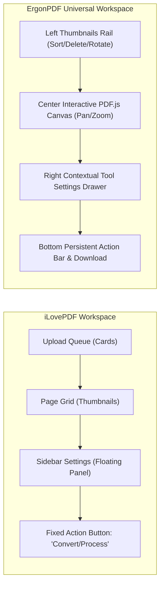

# User Experience (UX) & Interaction Workflow Analysis

## Executive Summary
This document presents an exhaustive UX reverse-engineering analysis comparing the interaction paradigms, information architecture, visual hierarchies, and user feedback mechanisms of **PDF24**, **iLovePDF**, and **ErgonPDF**.

Our goal is to identify industry-standard interaction best practices, isolate user friction points and dark patterns, and specify a modern, professional, and accessible UX architecture for ErgonPDF that honors its core identity: **Professional, local-first, zero-server PDF workstation**.

---

## 1. Information Architecture & Navigation

### 1.1 Tool Discovery & Category Organization

```mermaid
flowchart TD
    subgraph PDF24 ["PDF24 (Catalog-Heavy Directory Model)"]
        P_Home["Landing Page / All Tools Grid"] --> P_Cards["124 Dense Tool Cards (Flat)"]
        P_Cards --> P_Filter["Dynamic Live Keyword Filter"]
        P_Cards --> P_Tool["Individual Tool Page (/en/tool-name)"]
    end

    subgraph iLovePDF ["iLovePDF (Curated Freemium Hub)"]
        I_Nav["Top Mega-Menu (Convert, All Tools)"] --> I_Hero["Hero Grid (24 Core Cards)"]
        I_Hero --> I_Tool["Target Tool Page (/tool-name)"]
        I_Hero --> I_Pricing["Prominent 'Pricing' / 'Upgrade' CTA"]
    end

    subgraph ErgonPDF ["ErgonPDF (Single-Page Universal Workspace)"]
        E_Header["Sticky Header + Intent Search Bar"] --> E_Tabs["10 Category Filter Pills"]
        E_Tabs --> E_Grid["43 Interactive Glass Tool Cards"]
        E_Grid --> E_Workspace["In-Memory Universal Workspace (No URL Change)"]
    end
```

#### Comparison of Discovery Paradigms
1. **PDF24**:
   - Employs a dense, encyclopedia-style directory layout. All 124 tools are accessible from `https://tools.pdf24.org/en/all-tools`.
   - Offers a simple real-time text filter that instantly hides non-matching cards.
   - **Friction Point**: Visual overload. Browsing 124 cards with minimal category hierarchy causes decision paralysis. Heavy programmatic display ads interrupt visual scanning.
2. **iLovePDF**:
   - Curates a clean, high-contrast 4x6 grid of its primary tools on the home page, utilizing recognizable color accents (red, blue, green, yellow).
   - Dropdown mega-menus group tools logically by task ("Convert to PDF", "Convert from PDF", "All PDF Tools").
   - **Strength**: High visual clarity and instant brand recognition. Minimal cognitive load for novice users.
3. **ErgonPDF**:
   - Uses an **instant-load Single Page Application (SPA)** model. Selecting a tool does not navigate to a new web page; instead, it dynamically updates the active tool state within the universal client workspace.
   - Combines a persistent global keyword intent search with 10 category tab filters ("Organize", "Compress", "Edit & Sign", "Convert", etc.).
   - **Recommendation for ErgonPDF**: Preserve the single-page fluid transition, but improve card discoverability by introducing a "Recently Used Tools" row and pinning popular tools to the top of the grid.

---

## 2. Ingestion & File Dropzone Patterns

### 2.1 Drag-and-Drop Ingestion Mechanics

| Dimension | PDF24 | iLovePDF | ErgonPDF |
| :--- | :--- | :--- | :--- |
| **Dropzone Form Factor** | Large dashed container; yellow/orange sheep mascot branding. | Massive central red button ("Select PDF file") with drag-target viewport overlay. | Sleek glassmorphism dashed drop area with dynamic drag-hover glow. |
| **Multi-File Batch Drop** | ✅ Supported; shows thumbnail preview queue. | ✅ Supported; allows reordering files before conversion. | ✅ Supported for Merge/Batch; single-doc workspace for interactive tools. |
| **Cloud Storage Connectors** | Google Drive, Dropbox. | Google Drive, Dropbox (with OAuth authentication). | ❌ None (By design: files must remain local to preserve privacy). |
| **Mobile Handoff** | QR code pairing with mobile phone camera. | Native mobile app integration / QR handoff. | ✅ Direct local camera scan via HTML5 `getUserMedia`. |
| **File Size Feedback** | Shows warning if server timeout is likely. | Hard cutoff modal on free tier: *"File exceeds 15 MB. Upgrade to Premium."* | Instant local parsing; no artificial size limit; memory warning if >500MB. |

#### Analysis & Best Practices
- **iLovePDF's Dropzone Feedback**: When a user drags a file anywhere across the browser viewport, iLovePDF darkens the entire window and displays a full-screen drag target with an animated drop icon. This prevents accidental misses.
- **ErgonPDF Implementation Guidance**: Implement a viewport-wide `dragenter` listener so users can drop documents anywhere on the screen, not just inside the small dashed dropzone rectangle.

---

## 3. Document Previews & Canvas Manipulation

### 3.1 Workspace Architecture Comparison

#### Key Ergonomic Differences
1. **Multi-Page Grid vs. Center Canvas**:
   - **PDF24 and iLovePDF** primarily use a **multi-page grid** for page manipulation tasks (organize, split, rotate). Each page is represented as a sizable thumbnail card with hover action icons (rotate left, rotate right, delete).
   - **ErgonPDF** utilizes a professional **IDE / Workstation layout**: a vertical thumbnail rail on the left, an interactive high-resolution canvas in the center, and contextual tool configuration controls on the right.
2. **Interactive Annotations & Redactions**:
   - ErgonPDF's canvas-centric architecture is vastly superior for interactive tools: drawing signatures, placing watermarks, drawing blackout redactions, and stamping QR codes can be positioned visually with pixel precision directly over the active page.
   - In PDF24, editing and drawing tools open a separate pop-up viewer modal with significant UI lag.

---

## 4. Processing Indicators & Feedback States

### 4.1 State Progression Lifecycle

| State | PDF24 | iLovePDF | ErgonPDF |
| :--- | :--- | :--- | :--- |
| **1. Ingestion** | Upload progress bar (%) to backend. | Fast upload progress bar (%) to AWS S3. | Instant zero-latency local memory load (`ArrayBuffer`). |
| **2. Processing** | Generic spinner: *"Processing on server..."* (10–60s). | Animated illustration + percentage counter (5–30s). | Multi-stage text updates + CSS spinner (e.g. *"Rebuilding pages..."*, *"Applying redactions..."*). |
| **3. Completion** | Redirects to new URL (`/en/job-success/uuid`). | Redirects to `/download/taskId` screen. | Instant slide-up bottom action bar with confetti animation and file size delta. |
| **4. Error State** | Generic HTTP error message with retry button. | Toast notifications and upsell modals (e.g., password prompt or file size limit). | In-app modal alert with error description. |

#### ErgonPDF Strength
ErgonPDF's local execution provides **near-instantaneous completion (10ms to 500ms)** for operations that take competitors 15 to 45 seconds due to cloud upload/download roundtrips. The inclusion of `canvas-confetti` and exact byte savings metrics (`original: 2.2 KB -> newSize: 1.3 KB (-40%)`) provides delightful positive reinforcement.

---

## 5. Download & Post-Processing Interfaces

### 5.1 Post-Processing Actions

1. **PDF24 Download Screen**:
   - Large prominent download button.
   - Secondary buttons: Save to Google Drive, Dropbox, Send by Email, Fax (legacy), Delete file now.
   - "Continue in another tool": Allows feeding the output directly into another tool (e.g. Compress -> Protect).
2. **iLovePDF Download Screen**:
   - Primary download button with automated background download trigger (starts automatically after 3 seconds).
   - QR code for mobile download.
   - Cloud save icons.
   - Aggressive banner promoting the iLovePDF Desktop application.
3. **ErgonPDF Action Bar**:
   - Fixed glassmorphism action bar at the bottom of the workspace.
   - Single-click "Download PDF" button.
   - "Close & Open Another Tool" button.
   - **Recommendation**: Add a **"Chain Tool"** workflow button allowing users to seamlessly transition the modified in-memory document into a second tool (e.g., Redact -> Compress -> Protect) without re-downloading and re-uploading!

---

## 6. Accessibility & Responsive Design

### 6.1 Audit Findings
- **Keyboard Navigation**:
  - PDF24: Poor tab index management; screen readers get trapped in third-party advertisement iframes.
  - iLovePDF: Well-structured ARIA labels and focus rings on primary buttons.
  - ErgonPDF: Uses semantic HTML buttons, but lacks comprehensive keyboard shortcuts (e.g., `Ctrl+Z` for undo, `Delete` key for removing selected pages, arrow keys for thumbnail navigation).
- **Responsive Layouts**:
  - PDF24: Cards reflow cleanly on mobile, but editor canvas is virtually unusable on touchscreens.
  - iLovePDF: Mobile-first responsive views; mobile apps recommended on small screens.
  - ErgonPDF: Modern Tailwind/CSS variables layout with collapsible drawers on mobile viewports; camera scan works natively on mobile browsers.

---

## 7. Recommended UX Principles for ErgonPDF

1. **Zero-Latency Visual Feedback**: Emphasize speed. Highlight that operations happen in milliseconds right on the user's CPU.
2. **Persistent Tool Chaining**: Add a "Next Action" dropdown on the download bar (e.g. *"Now Compress this file"*, *"Now Sign this file"*), passing the `Uint8Array` directly into the next workspace state without disk I/O.
3. **Full-Viewport Drag Target**: Catch dropped files across the entire application window.
4. **Professional Workstation Density**: Maintain high information density and dark mode aesthetics, distinguishing ErgonPDF as a professional tool rather than a toy.
5. **No Clutter, No Ads, No Up-sells**: Keep the UI 100% clean and focused on user productivity.
